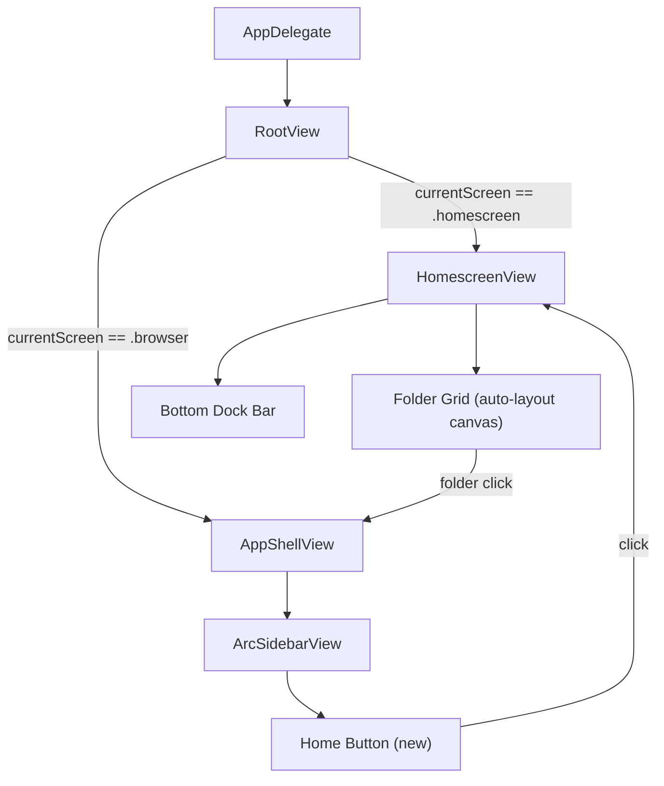
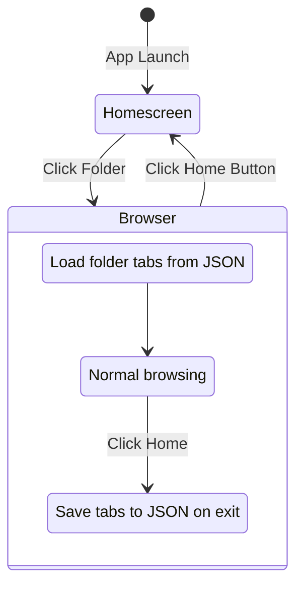

# Homescreen with Desktop-Style Folder Grid

## Architecture Overview




A new `**RootView**` sits above `AppShellView` and switches between the homescreen and browser. The homescreen is a macOS-desktop-style full canvas with folders in an auto-layout grid and a bottom dock bar. No sidebar, no widgets.

## State Flow




## Homescreen Layout

The homescreen fills the entire window -- no sidebar, no NavigationSplitView. Folders are arranged in a left-aligned column-major auto-grid (like macOS desktop icons).

```
+---------------------------------------------------------------+
|                                                               |
|  [Folder]  [Folder]  [Folder]                                |
|  Project-A Task-XYZ  Trip                                    |
|                                                               |
|  [Folder]  [Folder]  [Folder]                                |
|  Homework  Jira-1    Inc-123                                 |
|                                                               |
|  [  +  ]                                                     |
|  New Folder                                                  |
|                                                               |
|                                                               |
+---------------------------------------------------------------+
| [F1] [F2] [F3] [F4] [F5]  [+]  | Q Search |    17:47       |
|                                              |   FRI 27 FEB   |
+---------------------------------------------------------------+
```

Each folder icon: rounded rectangle with an SF Symbol folder icon (colored per folder) + name label below. The "+ New Folder" button sits at the end of the grid.

## Data Model Changes

### Evolve `Space` into `Folder`

Rename and extend [Sources/Bowser/Models/Space.swift](Sources/Bowser/Models/Space.swift):

```swift
struct Folder: Identifiable, Equatable, Sendable, Codable {
    let id: UUID
    var name: String
    var color: Color
    var icon: String       // SF Symbol name, default "folder.fill"
    var createdAt: Date
    var gridIndex: Int     // position in auto-layout grid
    var tabIds: [UUID]
}
```

### Evolve `SpacesManager` into `FolderManager`

Rename [Sources/Bowser/Services/SpacesManager.swift](Sources/Bowser/Services/SpacesManager.swift) to `FolderManager`:

- Same persistence handler pattern (JSON via UserDefaults)
- Add `createFolder(name:)` which appends with next `gridIndex`
- Add `reorderFolder(from:to:)` for potential future drag-reorder
- Default folders: "Project-A", "Task-XYZ", "Trip", "Homework", "Jira-1", "Inc-123"

### New: `AppNavigationState`

New file `Sources/Bowser/Models/AppNavigationState.swift`:

```swift
@Observable @MainActor
final class AppNavigationState {
    enum Screen: Equatable {
        case homescreen
        case browser(folderId: UUID)
    }
    var currentScreen: Screen = .homescreen
    var activeFolderId: UUID? {
        if case .browser(let id) = currentScreen { return id }
        return nil
    }
}
```

### New: `FolderTabPersistence`

New file `Sources/Bowser/Services/FolderTabPersistence.swift`:

- Directory: `~/Library/Application Support/Bowser/Folders/{folderId}/tabs.json`
- Same pattern as [PlanStorageManager](Sources/Bowser/Services/PlanStorageManager.swift)
- `SerializedTab` struct: url (String), title, faviconBase64 (optional), isPinned, parentTabId (optional)
- `saveTabs(folderId: UUID, tabs: [Tab])` and `loadTabs(folderId: UUID) -> [Tab]`

## New Views

### `RootView` -- new composition root

New file `Sources/Bowser/Views/RootView.swift`, replaces `AppShellView` as window content in AppDelegate:

```swift
struct RootView: View {
    @Bindable var appNav: AppNavigationState
    @Bindable var browserState: BrowserState
    
    var body: some View {
        ZStack {
            switch appNav.currentScreen {
            case .homescreen:
                HomescreenView(appNav: appNav, browserState: browserState)
            case .browser:
                AppShellView(browserState: browserState, appNav: appNav)
            }
        }
        .animation(.spring(response: 0.4, dampingFraction: 0.85), value: appNav.currentScreen)
    }
}
```

### `HomescreenView` -- full-screen desktop canvas

New file `Sources/Bowser/Views/Homescreen/HomescreenView.swift`:

- Full window, uses `UnifiedBackdropView` for consistent ArcTheme vibrancy
- `VStack`: folder grid canvas (fills space) + `HomescreenBottomBar` pinned to bottom
- Folder grid: `LazyVGrid` with adaptive columns (~100pt per item), iterating `FolderManager.folders` sorted by `gridIndex`
- Each cell: `FolderIconView`
- Last cell: "New Folder" button (same style but with "+" icon)
- Folder click action: `browserState.loadFolder(id:)` then `appNav.currentScreen = .browser(folderId:)`

### `FolderIconView` -- single folder on the desktop

New file `Sources/Bowser/Views/Homescreen/FolderIconView.swift`:

- Rounded rect (~64x64) filled with folder color at low opacity
- SF Symbol `folder.fill` tinted with folder color, centered
- Folder name label below (`.secondary`, 12pt)
- Hover: subtle scale + brightness lift (ArcTheme.hoverAnimation)
- Click: opens folder (transition to browser)
- Context menu: Rename, Change Color, Delete

### `HomescreenBottomBar` -- dock bar at bottom

New file `Sources/Bowser/Views/Homescreen/HomescreenBottomBar.swift`:

- Floats above bottom edge with rounded capsule background (`.ultraThinMaterial`)
- Left section: miniature folder icons (first 6-8 folders as quick-access dock)
- Center: "+" button to create new folder
- Center-right: search field ("Search Everything") -- visual only for now
- Right: clock (HH:mm) + date (ddd DD MMM) using `Timer` for live updates

## Modified Files

### [AppDelegate.swift](Sources/Bowser/AppDelegate.swift)

- Add `private let appNav = AppNavigationState()` property
- `createMainWindow()`: change `AppShellView(browserState:)` to `RootView(appNav: appNav, browserState: browserState)`
- Pass `appNav` alongside `browserState` to the hosting controller

### [AppShellView.swift](Sources/Bowser/Views/AppShellView.swift)

- Add `@Bindable var appNav: AppNavigationState` parameter
- Pass `appNav` through to `ArcSidebarView`
- No other structural changes

### [ArcSidebarView.swift](Sources/Bowser/Views/Shell/ArcSidebarView.swift)

- Add `@Bindable var appNav: AppNavigationState` parameter
- Replace the solo `settingsButton` at the bottom with an `HStack` of `homeButton` + `settingsButton`:

```swift
HStack(spacing: 8) {
    homeButton    // house.fill + "Home"
    settingsButton
}
```

- Home button action: `browserState.saveCurrentFolder()` then `appNav.currentScreen = .homescreen`

### [BrowserState.swift](Sources/Bowser/BrowserState.swift)

- Add `var currentFolderId: UUID?`
- Add `loadFolder(id: UUID)`:
  - Save current folder if one is active
  - Load tabs from `FolderTabPersistence` for the new folder
  - Replace `tabManager` tabs (or create default Google tab if empty/new folder)
  - Scope `PlanState` to folder
  - Reset `AgentState`
  - Set `currentFolderId = id`
- Add `saveCurrentFolder()`:
  - Guard `currentFolderId` is set
  - Serialize current `tabManager.tabs` via `FolderTabPersistence`
- Add `TabManager.replaceTabs(_:)` method to swap all tabs at once

### [PlanStorageManager.swift](Sources/Bowser/Services/PlanStorageManager.swift)

- Change from singleton to support folder-scoped instances
- Add `init(folderId: UUID)` that sets plans directory to `Bowser/Folders/{folderId}/Plans/`
- `BrowserState.planState` gets a new `PlanStorageManager` instance when loading a folder

### References: Space -> Folder rename

All files referencing `Space` / `SpacesManager` need updating:

- [BrowserState.swift](Sources/Bowser/BrowserState.swift) (spaces properties, init)
- Any sidebar views referencing spaces
- Grep for `Space` / `SpacesManager` / `spaces` across `Sources/Bowser/`

## Transition Flows

**Folder Click (Homescreen -> Browser):**

1. User clicks "Project-A" on the desktop grid
2. `BrowserState.loadFolder(folderId)` -> loads persisted tabs (or creates default Google tab)
3. `AppNavigationState.currentScreen = .browser(folderId: id)`
4. `RootView` animates crossfade/spring transition to `AppShellView`

**Home Button (Browser -> Homescreen):**

1. User clicks "Home" button in browser sidebar (bottom, beside Settings)
2. `BrowserState.saveCurrentFolder()` -> persists tabs to JSON
3. `AppNavigationState.currentScreen = .homescreen`
4. `RootView` animates transition back to `HomescreenView`

**New Folder:**

1. User clicks "+" on desktop grid or bottom bar
2. `FolderManager.createFolder(name: "New Folder")` with next `gridIndex`
3. Folder appears on grid, name is editable inline
4. Clicking it transitions to browser with a single default Google tab

## File Summary

- **New**: `Sources/Bowser/Models/Folder.swift`
- **New**: `Sources/Bowser/Models/AppNavigationState.swift`
- **New**: `Sources/Bowser/Services/FolderManager.swift`
- **New**: `Sources/Bowser/Services/FolderTabPersistence.swift`
- **New**: `Sources/Bowser/Views/RootView.swift`
- **New**: `Sources/Bowser/Views/Homescreen/HomescreenView.swift`
- **New**: `Sources/Bowser/Views/Homescreen/FolderIconView.swift`
- **New**: `Sources/Bowser/Views/Homescreen/HomescreenBottomBar.swift`
- **Modify**: `Sources/Bowser/AppDelegate.swift`
- **Modify**: `Sources/Bowser/Views/AppShellView.swift`
- **Modify**: `Sources/Bowser/Views/Shell/ArcSidebarView.swift`
- **Modify**: `Sources/Bowser/BrowserState.swift`
- **Modify**: `Sources/Bowser/Services/PlanStorageManager.swift`
- **Rename+Extend**: `Space.swift` -> `Folder.swift`, `SpacesManager.swift` -> `FolderManager.swift`

