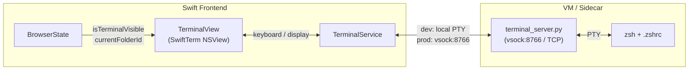

# Integrated VM Terminal Module

## Architecture

The terminal is a full-screen takeover view that replaces the browser content, following the same pattern as the homescreen-to-browser transition in `RootView`. The terminal connects to a PTY running inside the VM (production) or a local shell (development).




### Dual Mode (paralleling `BackendService`)

- **Development**: `TerminalService` spawns a local zsh process via SwiftTerm's `LocalProcess` API. No VM needed.
- **Production**: `TerminalService` connects to the VM's terminal server on vsock port 8766. PTY lives inside the Linux VM.

### Per-Folder Sessions

- Each browser folder (`currentFolderId`) maps to a directory in the VM: `/home/bowser/workspaces/<folderId>/`
- Terminal sessions are named by `folderId` and managed via tmux (sessions persist across reconnects and app restarts)
- Opening a terminal for a folder attaches to the existing tmux session or creates a new one `cd`'d to the folder directory

### View Switching

The terminal is a full-view swap in `[AppShellView.swift](Sources/Bowser/Views/AppShellView.swift)`, following the `RootView` pattern (ZStack with opacity + `allowsHitTesting`):

```swift
ZStack {
    UnifiedBackdropView()
    
    // Browser (kept alive to preserve CEF state)
    mainContent
        .opacity(isTerminalVisible ? 0 : 1)
        .allowsHitTesting(!isTerminalVisible)
    
    // Terminal (full takeover with header bar)
    if hasTerminalBeenOpened {
        TerminalContainerView(...)
            .opacity(isTerminalVisible ? 1 : 0)
            .allowsHitTesting(isTerminalVisible)
    }
}
```

---

## New Files

### Swift (Frontend)

1. `**[Sources/Bowser/Views/Terminal/TerminalContainerView.swift](Sources/Bowser/Views/Terminal/TerminalContainerView.swift)**`
  - Full-screen terminal view with a header bar
  - Header bar contains a "Show Browser" button (arrow-down icon) that toggles back to browser
  - Hosts the SwiftTerm `TerminalView` via NSViewRepresentable
  - Receives `folderId` from `BrowserState` and tells `TerminalService` to attach/create session
2. `**[Sources/Bowser/Services/TerminalService.swift](Sources/Bowser/Services/TerminalService.swift)**`
  - `@Observable @MainActor` service (added to `BrowserState` like `MeetingRecorderService`)
  - `isTerminalVisible: Bool` -- drives the view toggle
  - `activeSessionId: String?` -- current tmux session name (= folderId)
  - `openTerminal(folderId:)` -- creates/attaches to session
  - `closeTerminal()` -- detaches (session stays alive in VM)
  - Dev mode: uses `LocalProcess` (SwiftTerm) to fork local zsh
  - Prod mode: connects to vsock port 8766, sends handshake (`folderId`), then streams raw PTY data
  - Implements SwiftTerm's `TerminalViewDelegate` for data bridging

### Python (Backend / VM)

1. `**[Sidecar/app/services/terminal_server.py](Sidecar/app/services/terminal_server.py)**`
  - Standalone asyncio server listening on port 8766 (vsock in prod, TCP in dev)
  - Handshake protocol: client sends `{"folder_id": "xxx"}` as first line; server responds `{"status": "ok", "session_id": "xxx"}`
  - After handshake, raw PTY data flows bidirectionally
  - Uses tmux under the hood: `tmux new-session -d -s <folderId> -c /home/bowser/workspaces/<folderId>` (create) or `tmux attach -t <folderId>` (attach)
  - Creates folder directory if it doesn't exist
  - zsh is the default shell (loads `.zshrc`)
2. `**[Sidecar/app/routes/terminal_routes.py](Sidecar/app/routes/terminal_routes.py)**`
  - REST endpoints (on existing port 8765) for session management:
    - `GET /api/terminal/sessions` -- list active tmux sessions
    - `POST /api/terminal/sessions` -- create a new session for a folder
    - `DELETE /api/terminal/sessions/{session_id}` -- kill a session
  - Used by Swift for session lifecycle management, not for PTY streaming

---

## Modified Files

### Swift

1. `**[Package.swift](Package.swift)**`
  - Add SwiftTerm as SPM dependency: `.package(url: "https://github.com/migueldeicaza/SwiftTerm.git", from: "...")`
  - Add `SwiftTerm` to the `Bowser` target's dependencies
2. `**[Sources/Bowser/BrowserState.swift](Sources/Bowser/BrowserState.swift)**`
  - Add `let terminalService: TerminalService` to sub-managers
  - Initialize in `init()`
3. `**[Sources/Bowser/Views/Shell/ArcSidebarView.swift](Sources/Bowser/Views/Shell/ArcSidebarView.swift)**`
  - Add a "Terminal" item to `toolsGrid` (after existing tools, before Record):

```swift
toolGridItem(icon: "terminal", label: "Terminal") {
    browserState.terminalService.toggleTerminal(
        folderId: browserState.currentFolderId
    )
}
```

1. `**[Sources/Bowser/Views/AppShellView.swift](Sources/Bowser/Views/AppShellView.swift)**`
  - Add `@State private var hasTerminalBeenOpened = false` (same pattern as `RootView.hasBrowserBeenOpened`)
  - Wrap `mainContent` and `TerminalContainerView` in ZStack with opacity/`allowsHitTesting` toggle
  - Observe `browserState.terminalService.isTerminalVisible` to drive transitions
  - Animation: `.spring(response: 0.35, dampingFraction: 0.9)` (matching RootView)
2. `**[Sources/Bowser/Views/BrowserView.swift](Sources/Bowser/Views/BrowserView.swift)**` (or new gesture handler on `AppShellView`)
  - Add 3-finger vertical swipe detection using `NSEvent.addLocalMonitorForEvents(matching: .scrollWheel)` with touch count tracking
  - Swipe up (negative deltaY) with 3 touches --> show terminal
  - Swipe down (positive deltaY) with 3 touches --> show browser
  - Note: may conflict with macOS system gestures if user has "Mission Control = 3-finger swipe up" enabled. Include a note/preference to configure this.

### Python

1. `**[Sidecar/app/main.py](Sidecar/app/main.py)**`
  - Import and include `terminal_routes` router
    - In lifespan startup, start the terminal server on a background thread/task (port 8766)

---

## 3-Finger Gesture Implementation

On macOS, 3-finger swipe detection is done via scroll wheel event monitoring with touch count inspection. The implementation adds a local event monitor in `AppShellView`'s coordinator (AppKit layer):

- Monitor `.scrollWheel` events
- When `event.phase == .began`, reset accumulator
- On `.changed`, accumulate `scrollingDeltaY`; check touch count via `event.touchesMatching(.touching, in: nil).count == 3` (or use a `gestureRecognizer` if view-scoped)
- On `.ended`, if accumulated vertical delta exceeds threshold and touch count was 3, toggle terminal
- Caveat: System Preferences > Trackpad > "Mission Control" and "App Expose" gestures may intercept 3-finger swipes before the app sees them. Users may need to change these to 4-finger or disable them.

---

## Session Lifecycle

1. **User clicks "Terminal" in sidebar** (or 3-finger swipe up):
  - `TerminalService.openTerminal(folderId:)` called
  - REST call to `POST /api/terminal/sessions` with folderId (creates tmux session + directory if needed)
  - Opens vsock connection to port 8766, sends handshake with folderId
  - After handshake, raw PTY data streams to SwiftTerm view
  - `isTerminalVisible = true` triggers view transition
2. **User clicks "Show Browser" button** (or 3-finger swipe down):
  - `isTerminalVisible = false` triggers transition back to browser
  - vsock connection stays alive (PTY session continues in background)
3. **User switches folder**:
  - Current terminal detaches
  - New folder's terminal session is attached (or created)
4. **App restart**:
  - tmux sessions persist in VM
  - On re-open, `TerminalService` re-attaches to existing session for the current folder

---

## Key Dependencies

- **SwiftTerm** (SPM): Native macOS terminal emulator -- provides `TerminalView` (NSView), `Terminal` (emulator core), `LocalProcess` (PTY fork)
- **tmux** (in VM image): Session persistence and multiplexing -- must be installed in the Alpine Linux VM image
- **zsh** (in VM image): Default shell with `.zshrc` support -- must be installed in the VM image

