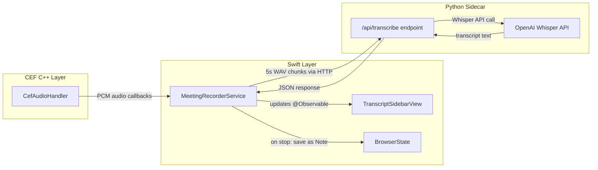
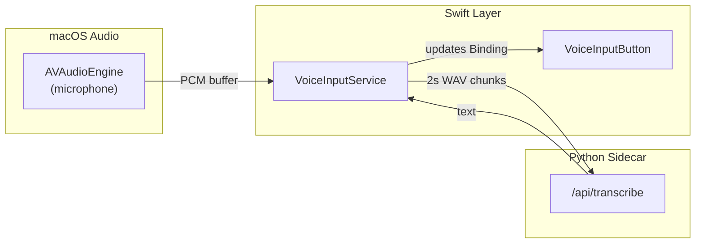

# Meeting Recorder (Granola-style) Implementation Plan

## Architecture Overview




## Layer 1: CEF Audio Capture (C++)

CEF provides `CefAudioHandler` which intercepts all audio output from the browser -- each WebRTC peer, media element, and Web Audio context gets its own stream with a unique ID.

### Files to modify

**[Sources/CEFWrapper/include/cef_shim.h](Sources/CEFWrapper/include/cef_shim.h)** -- Add new C API:

```c
// Audio capture callbacks
typedef void (*CefAudioDataCallback)(
    CefBrowserHandle handle,
    int stream_id,
    const float *data,
    int frames,
    int channels,
    int sample_rate
);
typedef void (*CefAudioStreamStartedCallback)(
    CefBrowserHandle handle,
    int stream_id,
    int channels,
    int sample_rate
);
typedef void (*CefAudioStreamStoppedCallback)(
    CefBrowserHandle handle,
    int stream_id
);

void cef_start_audio_capture(CefBrowserHandle handle);
void cef_stop_audio_capture(CefBrowserHandle handle);
void cef_register_audio_callbacks(
    CefBrowserHandle handle,
    CefAudioDataCallback data_cb,
    CefAudioStreamStartedCallback started_cb,
    CefAudioStreamStoppedCallback stopped_cb
);
```

**[Sources/CEFWrapper/shim_impl.cpp](Sources/CEFWrapper/shim_impl.cpp)** -- Add `CefAudioHandler` to `SimpleClient`:

- Implement `GetAudioHandler()` returning `this`
- Implement `OnAudioStreamStarted(browser, params, channels)` -- forward stream metadata to Swift callback
- Implement `OnAudioStreamPacket(browser, data, frames, pts)` -- forward PCM float data to Swift callback
- Implement `OnAudioStreamStopped(browser)` -- notify Swift stream ended
- `CefAudioHandler` delivers interleaved float PCM data per stream, which naturally separates WebRTC participants (each remote peer = separate stream ID)

## Layer 2: Swift Service + Bridge

### New files

`**Sources/Bowser/Services/MeetingRecorderService.swift`** -- Core recording service:

- `@Observable @MainActor` class owned by `BrowserState`
- Properties: `isRecording`, `isPaused`, `transcriptSegments: [TranscriptSegment]`, `activeStreams: [Int: AudioStreamInfo]`
- `TranscriptSegment` struct: `id`, `text`, `speakerLabel`, `timestamp`, `streamId`
- `AudioStreamInfo` struct: `streamId`, `channels`, `sampleRate`, `label`
- On `startRecording()`: calls `cef_start_audio_capture` on the active tab's browser handle, starts a 5-second chunking timer
- Audio callback accumulates PCM samples into a per-stream ring buffer
- Every 5 seconds, encodes buffered audio as WAV, sends to Sidecar `/api/transcribe`
- On response, appends `TranscriptSegment` to `transcriptSegments` (triggers UI update)
- `pauseRecording()`: pauses the chunking timer (audio callbacks still fire but data is discarded)
- `stopRecording()`: stops capture, flushes remaining audio, saves transcript as a Note via `NotePersistence`

`**Sources/Bowser/CEF/CEFAudioBridge.swift`** -- Thin wrapper bridging C callbacks to Swift:

- Registers C audio callbacks with `cef_register_audio_callbacks`
- Converts C float pointer + frame count to Swift `[Float]` arrays
- Dispatches to `MeetingRecorderService` on MainActor

`**Sources/Bowser/Models/TranscriptSegment.swift`** -- Model:

```swift
struct TranscriptSegment: Identifiable, Codable {
    let id: UUID
    let text: String
    let speakerLabel: String?
    let timestamp: Date
    let streamId: Int?
}
```

### Files to modify

**[Sources/Bowser/BrowserState.swift](Sources/Bowser/BrowserState.swift)** -- Add `meetingRecorderService` property alongside existing services (line ~68):

```swift
let meetingRecorderService: MeetingRecorderService
```

Initialize in `init()` and wire it up.

**[Sources/Bowser/CEF/CEFBridge.swift](Sources/Bowser/CEF/CEFBridge.swift)** -- Add `startAudioCapture(handle:)` and `stopAudioCapture(handle:)` methods that call the C shim functions.

## Layer 3: Transcript Right Sidebar (SwiftUI)

### New file

`**Sources/Bowser/Views/MeetingRecorder/TranscriptSidebarView.swift`** -- Right sidebar:

- Shown when `meetingRecorderService.isRecording` is true
- `ScrollViewReader` with auto-scroll to bottom as new segments arrive
- Each segment shows: timestamp, speaker label (if available, color-coded), transcript text
- **Top bar**: recording indicator (pulsing red dot), elapsed time, meeting URL
- **Bottom bar**: Pause button (toggle), Stop button
- On Stop: prompt for title, then save as Note in current folder
- Visual style: matches existing sidebar aesthetic (`.ultraThinMaterial` background, similar to `WorkflowSidebarView`)

### Files to modify

**[Sources/Bowser/Views/Shell/FloatingWebCanvasView.swift](Sources/Bowser/Views/Shell/FloatingWebCanvasView.swift)** -- Wrap the main content in an `HStack` when recording is active:

```swift
HStack(spacing: 0) {
    // existing Group { ... } content
    existingContent
        .frame(maxWidth: .infinity)
    
    if browserState.meetingRecorderService.isRecording {
        TranscriptSidebarView(recorder: browserState.meetingRecorderService)
            .frame(width: 320)
            .transition(.move(edge: .trailing))
    }
}
```

**[Sources/Bowser/Views/Shell/ArcSidebarView.swift](Sources/Bowser/Views/Shell/ArcSidebarView.swift)** -- Add "Record" tool to the tools grid (line ~582):

```swift
toolGridItem(
    icon: browserState.meetingRecorderService.isRecording
        ? "record.circle.fill" : "record.circle",
    label: "Record"
) {
    if browserState.meetingRecorderService.isRecording {
        browserState.meetingRecorderService.stopRecording()
    } else {
        browserState.meetingRecorderService.startRecording()
    }
}
```

The grid changes from 2x2 to 2x3 (5 items, wraps naturally with `LazyVGrid`).

## Layer 4: Python Sidecar Transcription Endpoint

### New file

`**Sidecar/app/routes/transcribe_routes.py**` -- FastAPI router:

- `POST /api/transcribe` -- accepts `multipart/form-data` with WAV audio file + optional `stream_id`
- Calls OpenAI Whisper API (`client.audio.transcriptions.create(model="whisper-1", file=audio_file)`)
- Returns `{ "text": "...", "stream_id": ..., "timestamp": "..." }`
- Handles errors gracefully (returns empty text on failure, logs error)

### New file

`**Sidecar/app/services/transcription_service.py**` -- Service layer:

- Manages OpenAI client for Whisper
- `async def transcribe_chunk(audio_data: bytes, format: str = "wav") -> str`
- Uses the existing OpenAI API key from app configuration (`/api/configure` already sets it)
- Optional: batch multiple stream chunks into a single request with speaker labels

### Files to modify

**[Sidecar/app/main.py](Sidecar/app/main.py)** -- Mount the new router:

```python
from app.routes.transcribe_routes import router as transcribe_router
app.include_router(transcribe_router, prefix="/api/transcribe")
```

**[Sidecar/requirements.txt](Sidecar/requirements.txt)** -- No changes needed (`openai>=1.0.0` already present).

## Saving Transcript as Note

When the user hits Stop:

1. `MeetingRecorderService.stopRecording()` calls `cef_stop_audio_capture`
2. Flushes any remaining buffered audio for final transcription
3. Assembles all `TranscriptSegment`s into formatted RTFD content (timestamps as headers, speaker labels as bold prefixes, transcript text as body)
4. Creates a `Note` with title like "Meeting - {page_title} - {date}" and the RTFD content
5. Saves via `NotePersistence.shared.saveNote(note, forFolder: currentFolderId)`
6. Opens the note in a tab via `browserState.openNoteTab(noteId:title:)`

## Speaker Detection (Built-in)

CEF's `CefAudioHandler` naturally separates audio by stream. In WebRTC meetings (Zoom, Meet, Teams), each remote participant produces a separate audio stream with a unique `stream_id`. The recorder:

- Tracks streams via `OnAudioStreamStarted` / `OnAudioStreamStopped`
- Labels them as "Speaker 1", "Speaker 2", etc. (or by stream metadata if available)
- Each transcript segment carries its `streamId`, displayed with color-coded speaker labels in the sidebar
- This gives per-person transcripts with zero extra dependencies

**Future enhancement**: Add `pyannote-audio` for diarization on mixed/single-stream audio (e.g., when a meeting app mixes all participants into one stream).

## Layer 5: Universal Voice-to-Text Input (Mic Button)

Reuses the same Sidecar `/api/transcribe` endpoint but captures **microphone audio** (via macOS `AVAudioEngine`) instead of CEF tab audio. A reusable mic button component can be dropped into any text input across the app.




### New files

`**Sources/Bowser/Services/VoiceInputService.swift**` -- Singleton microphone transcription service:

- `@Observable @MainActor` class, shared singleton
- Uses `AVAudioEngine` with an input node tap to capture microphone PCM audio
- Buffers audio and sends 2-second WAV chunks to Sidecar `/api/transcribe` (shorter than meeting recorder for snappy dictation)
- Properties: `isListening: Bool`, `partialText: String` (latest chunk result)
- `startListening(onTranscript: @escaping (String) -> Void)` -- starts mic capture, calls closure with each transcribed chunk
- `stopListening()` -- stops mic, flushes final chunk
- Requests microphone permission via `AVCaptureDevice.requestAccess(for: .audio)` on first use
- Handles errors gracefully (no mic permission, Sidecar down, etc.)

`**Sources/Bowser/Views/Components/VoiceInputButton.swift**` -- Reusable SwiftUI component:

```swift
struct VoiceInputButton: View {
    @Binding var text: String
    @State private var isListening = false
    
    var body: some View {
        Button(action: toggleListening) {
            Image(systemName: isListening ? "mic.fill" : "mic")
                .foregroundStyle(isListening ? .red : .secondary)
                .font(.system(size: 14))
                .symbolEffect(.pulse, isActive: isListening)
        }
        .buttonStyle(.plain)
        .help(isListening ? "Stop dictation" : "Start dictation")
    }
}
```

- Takes a `Binding<String>` to the text field's content
- Toggle behavior: tap to start listening, tap again to stop
- While listening: appends transcribed text to the binding as chunks arrive
- Pulsing red mic icon while active
- Compact size to fit inline next to any text field

### Files to modify (priority text inputs)

Add `VoiceInputButton(text: $queryText)` next to these text fields:


| Priority | File                                                                                         | Input             | Description                     |
| -------- | -------------------------------------------------------------------------------------------- | ----------------- | ------------------------------- |
| 1        | [CommandBarView.swift](Sources/Bowser/Views/CommandBarView.swift) ~L262                      | Search/URL bar    | Main omnibox -- most used input |
| 2        | [AgentChatBarView.swift](Sources/Bowser/Views/AgentChatBarView.swift) ~L31                   | Agent chat        | "Ask the agent..."              |
| 3        | [ChatWindowView.swift](Sources/Bowser/Views/ChatBubble/ChatWindowView.swift) ~L173           | Chat bubble       | "Ask a question..."             |
| 4        | [HomescreenBottomBar.swift](Sources/Bowser/Views/Homescreen/HomescreenBottomBar.swift) ~L120 | Homescreen search | "Search Anything"               |
| 5        | [PlanModeView.swift](Sources/Bowser/Views/PlanModeView.swift) ~L87                           | Plan intent       | "Enter your intent..."          |
| 6        | [LeafExecutionView.swift](Sources/Bowser/Views/LeafExecutionView.swift) ~L173                | AI tutor chat     | "Ask a question..."             |


**Not adding mic to**: SecureField (API keys/passwords), inline rename fields (folder names), filter/search fields (history, plans -- too short to dictate), settings fields (one-time config).

### Integration pattern

Each integration is minimal -- add the button inline in the `HStack` next to the existing `TextField`:

```swift
HStack {
    TextField("Search or enter URL...", text: $queryText)
    VoiceInputButton(text: $queryText)  // <-- one line addition
}
```

For multiline inputs (PlanModeView, AgentChatBarView), the button goes in the input's toolbar/accessory area.

### Keyboard shortcut

Add a global keyboard shortcut `Cmd+Shift+D` (D for dictation) that activates voice input on the currently focused text field. This would be registered in [AppShellView.swift](Sources/Bowser/Views/AppShellView.swift) as a `.keyboardShortcut`.

## Additional Features to Consider (future)

- **AI Summary**: After stop, send full transcript to GPT-4 for meeting summary, action items, key decisions
- **Search**: Full-text search across saved meeting transcripts
- **Export**: Export as Markdown, PDF, or share link
- **Auto-detect meetings**: Detect when user navigates to meet.google.com, zoom.us, teams.microsoft.com and prompt to record
- **Keyboard shortcut**: Cmd+Shift+R to toggle recording
- **Audio playback sync**: Store audio alongside transcript for playback with highlighted text
- **Continuous dictation mode**: Hold-to-talk vs toggle mode for voice input button
- **Language detection**: Auto-detect spoken language and pass to Whisper for multilingual support

