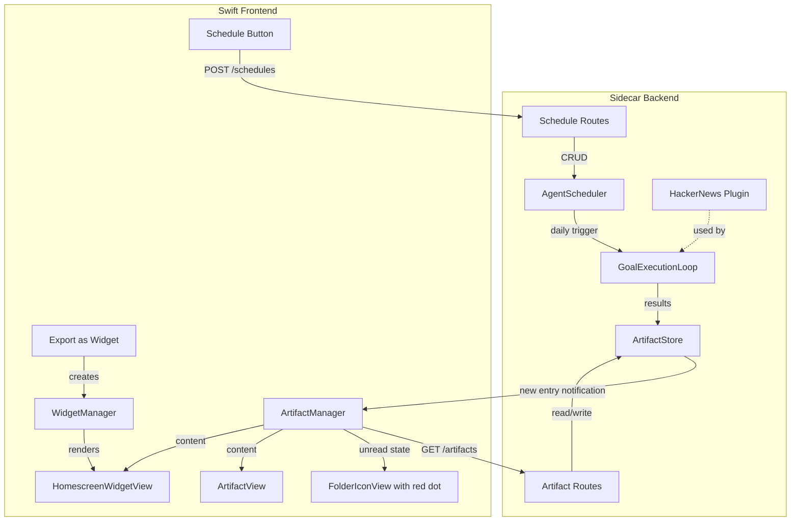

# Scheduled Agents, Artifacts, and Homescreen Widgets

This is a large feature spanning backend scheduling, persistence, a new plugin, artifact management, and a homescreen widget system. The work is organized into 3 tasks matching the user's breakdown plus shared infrastructure.

---

## Shared Infrastructure: HackerNews Plugin

**New file:** `Sidecar/app/services/plugins/hackernews_plugin.py`

- Create a `get_hackernews_plugin()` following the existing plugin pattern (like [http_plugin.py](Sidecar/app/services/plugins/http_plugin.py))
- Skills:
  - `fetchLaunches` -- calls the HN API (`https://hacker-news.firebaseio.com/v0/`) to get today's "Show HN" / "Launch YC" posts. Filters by date to avoid repeats.
  - `describeProduct` -- takes a product URL/title, uses web search (via the existing `AIAgent` + tools) to generate a few-line description + image URL
- Register the plugin in `Sidecar/app/main.py` lifespan alongside existing plugins

---

## Task 1: Scheduled Agent Runs + Artifact System

### 1a. Backend: Scheduled Execution Engine

**New file:** `Sidecar/app/services/scheduler.py`

- `AgentScheduler` class using `asyncio` with a background task that fires at a configured interval (daily = every 24h, checking once per minute for "has the day's run happened?")
- Stores schedule configs in a JSON file on disk: `~/.bowser/schedules.json`

```json
  {
    "schedule_id": "...",
    "agent_query": "Use HackerNews API to get YC launch products...",
    "folder_id": "...",
    "frequency": "daily",
    "plugin_ids": ["hackernews", "http"],
    "artifact_id": "...",
    "last_run_date": "2026-03-24",
    "created_at": "..."
  }
  

```

- On trigger: runs the agent goal loop programmatically (reuses `GoalPlannerAgent` + `GoalExecutionLoop` from [agent_service.py](Sidecar/app/services/agent_service.py) and [goal_executor.py](Sidecar/app/services/goal_executor.py)) with `auto_approve=True` (no human gate)
- After execution: appends results to the artifact file

### 1b. Backend: Artifact File System

**New file:** `Sidecar/app/services/artifact_store.py`

- Artifacts are JSON files stored at `~/.bowser/artifacts/{artifact_id}.json`
- Structure:

```json
  {
    "artifact_id": "...",
    "title": "YC Launch Products Daily",
    "folder_id": "...",
    "entries": [
      {
        "date": "2026-03-24",
        "items": [
          { "title": "ProductX", "url": "...", "image": "...", "description": "..." }
        ]
      }
    ]
  }
  

```

- Deduplication: before appending, check existing entries to skip products already recorded (match by URL or title)
- Provides `append_entry()`, `get_artifact()`, `list_artifacts()` methods

### 1c. Backend: New API Routes

**New file:** `Sidecar/app/routes/schedule_routes.py`

- `POST /api/schedules` -- create a new scheduled agent (query, folder_id, frequency, plugin_ids)
- `GET /api/schedules` -- list all schedules
- `DELETE /api/schedules/{schedule_id}` -- remove a schedule
- `GET /api/artifacts/{artifact_id}` -- get full artifact content (for GenerativeUI rendering)
- `GET /api/artifacts` -- list artifacts (optionally by folder_id)
- `POST /api/artifacts/{artifact_id}/mark-read` -- mark artifact as read (clears notification dot)
- Mount in [main.py](Sidecar/app/main.py), start scheduler in lifespan

### 1d. Frontend: Schedule Button + Notification Dot

**Modify:** [AgentState.swift](Sources/Bowser/Models/AgentState.swift)

- Add `ScheduledAgent` model: `id`, `query`, `folderId`, `frequency`, `pluginIds`, `artifactId`, `lastRunDate`
- Add `ScheduleManager` (or integrate into `AgentState`): methods to create/delete schedules via the new backend routes

**New model:** `Sources/Bowser/Models/ArtifactState.swift`

- `Artifact` model matching the backend JSON structure
- `ArtifactEntry` with date + items array
- `ArtifactItem` with title, url, image, description
- `ArtifactManager` -- fetches artifacts from backend, tracks read/unread state (persisted in UserDefaults)

**Modify:** [Folder.swift](Sources/Bowser/Models/Folder.swift)

- No structural change needed; unread state is tracked by `ArtifactManager` keyed by `folderId`

**Modify:** [FolderIconView.swift](Sources/Bowser/Views/Homescreen/FolderIconView.swift)

- Accept an `hasUnreadArtifact: Bool` parameter
- Overlay a small red circle (notification dot) on the top-right corner of the folder icon when `true`

**Modify:** [HomescreenView.swift](Sources/Bowser/Views/Homescreen/HomescreenView.swift)

- Pass `hasUnreadArtifact` from `ArtifactManager` into each `FolderIconView`
- Inject `ArtifactManager` as an environment object or via `BrowserState`

**New view:** `Sources/Bowser/Views/Agent/ScheduleButton.swift`

- A "Schedule" button in the agent mode UI (alongside existing run/approve buttons)
- On tap: shows a popover with frequency picker (only "Daily" for now) and confirm
- Calls `ScheduleManager.createSchedule()`

**New view:** `Sources/Bowser/Views/Agent/ArtifactView.swift`

- Full-page view for displaying an artifact's entries
- Uses existing GenerativeUI components: carousel for items within a day, date headers for segmentation
- Each item rendered as a card with image, title, description (reuse `UILibrary` carousel/destination-card components)
- Accessible from the agent session view when an artifact is attached

**Modify:** Agent mode views (the sidebar agent panel)

- Show attached artifact link on completed scheduled agent sessions
- Clicking the artifact link navigates to `ArtifactView`

### 1e. Frontend: BrowserState Integration

**Modify:** [BrowserState.swift](Sources/Bowser/BrowserState.swift)

- Add `artifactManager: ArtifactManager` property, initialized in `init()`
- On `loadFolder()`: fetch artifacts for the folder, mark as read

---

## Task 2: Homescreen Widgets

### 2a. Widget Model + State

**New file:** `Sources/Bowser/Models/WidgetState.swift`

- `HomescreenWidget` model:
  - `id: UUID`
  - `artifactId: String` -- links to an artifact
  - `position: CGPoint` -- x,y on homescreen canvas
  - `size: CGSize` -- width, height (user-resizable)
  - `displayMode: WidgetDisplayMode` -- `.carousel` or `.scroll`
  - `isVisible: Bool` -- hidden after close, reappears on next agent run
- `WidgetManager`:
  - Persists widgets to UserDefaults (`bowser.widgets`)
  - `addWidget()`, `removeWidget()`, `updatePosition()`, `updateSize()`, `showWidget()` (called after scheduled run)
  - `widgetsForHomescreen` computed property

### 2b. Widget Views

**New file:** `Sources/Bowser/Views/Homescreen/HomescreenWidgetView.swift`

- `HomescreenWidgetView` -- renders a single widget on the homescreen
  - Frosted glass/vibrancy card matching the app's `ArcTheme`
  - Header bar with artifact title + close (X) button
  - Content: either carousel (swipe through items) or scrollable list
  - Shows only the latest day's entries by default
  - Resize handles on edges/corners (`.gesture(DragGesture)` for resize)
  - Drag gesture on header for repositioning

**Modify:** [HomescreenView.swift](Sources/Bowser/Views/Homescreen/HomescreenView.swift)

- Layer widgets on top of the folder grid in the ZStack
- Each widget positioned absolutely using `.position(x:y:)` from its stored position
- Widgets are `ForEach(widgetManager.widgetsForHomescreen)` rendered as `HomescreenWidgetView`
- Pass `widgetManager` from `BrowserState`

### 2c. Export as Widget Button

**Modify:** `ArtifactView.swift` (created in Task 1)

- Add "Export as Widget" button in the artifact view header
- On tap: creates a `HomescreenWidget` linked to this artifact, positioned at center of screen
- Navigates back to homescreen to show the new widget

**Modify:** [BrowserState.swift](Sources/Bowser/BrowserState.swift)

- Add `widgetManager: WidgetManager` property

### 2d. Widget Lifecycle

- When a scheduled agent runs and produces new output:
  - Backend appends to artifact file
  - Frontend `ArtifactManager` detects new content
  - `WidgetManager.showWidget(artifactId:)` makes any hidden widgets for that artifact visible again
  - Widget content auto-refreshes from `ArtifactManager`

---

## Data Flow Summary




---

## Key Files Changed/Created Summary


| Action     | File                                                                      |
| ---------- | ------------------------------------------------------------------------- |
| **Create** | `Sidecar/app/services/plugins/hackernews_plugin.py`                       |
| **Create** | `Sidecar/app/services/scheduler.py`                                       |
| **Create** | `Sidecar/app/services/artifact_store.py`                                  |
| **Create** | `Sidecar/app/routes/schedule_routes.py`                                   |
| **Modify** | `Sidecar/app/main.py` (register plugin, routes, start scheduler)          |
| **Create** | `Sources/Bowser/Models/ArtifactState.swift`                               |
| **Create** | `Sources/Bowser/Models/WidgetState.swift`                                 |
| **Modify** | `Sources/Bowser/Models/AgentState.swift` (schedule model + methods)       |
| **Modify** | `Sources/Bowser/BrowserState.swift` (add managers)                        |
| **Modify** | `Sources/Bowser/Views/Homescreen/FolderIconView.swift` (notification dot) |
| **Modify** | `Sources/Bowser/Views/Homescreen/HomescreenView.swift` (widgets layer)    |
| **Create** | `Sources/Bowser/Views/Agent/ScheduleButton.swift`                         |
| **Create** | `Sources/Bowser/Views/Agent/ArtifactView.swift`                           |
| **Create** | `Sources/Bowser/Views/Homescreen/HomescreenWidgetView.swift`              |


