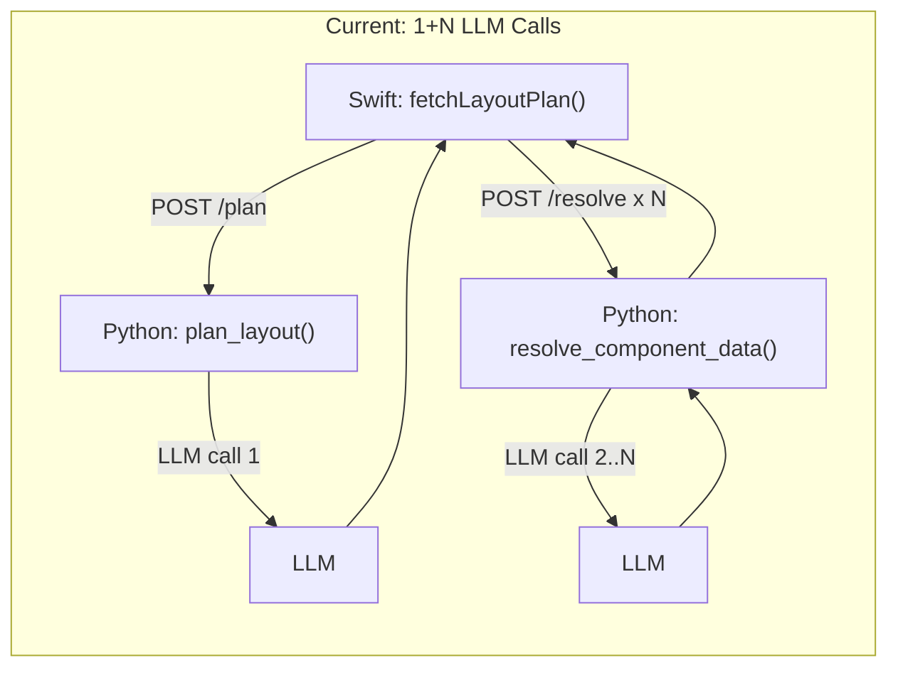
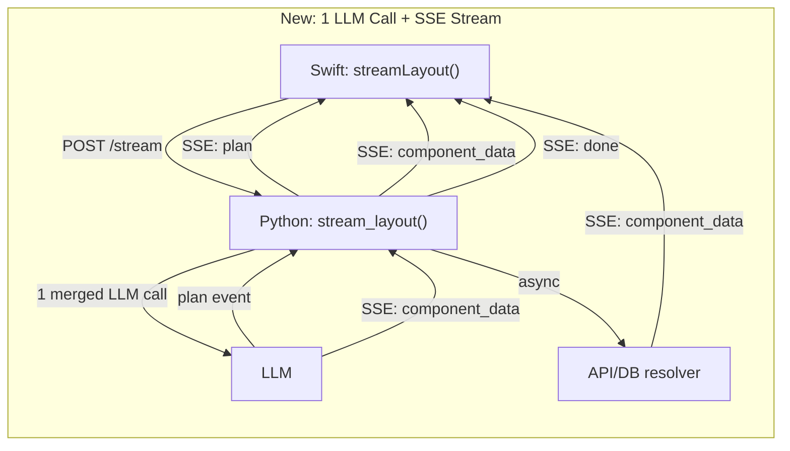

# Streaming Generative UI Refactor

## Architecture: Before and After







## Key Decisions

- **Keep JSON** (no OpenUI Lang DSL) — every LLM handles JSON well, and we keep existing schema validation
- **Single merged LLM call** emits plan + all LLM-sourced component data in one response, cutting N round-trips to 1
- **Resolver dispatch** routes each component to either LLM, API, or static data source
- **SSE stream** sends each component to Swift the instant its data is ready — reusing the existing SSE pattern from [agent_routes.py](Sidecar/app/routes/agent_routes.py) (Python) and [AgentState.swift](Sources/Bowser/Models/AgentState.swift) (Swift)
- **Unified registry** — `registry.json` becomes the single source of truth; the Swift enum and Python loader both derive from it
- **Co-located prompt instructions** — per-component LLM instructions move from Python `if/elif` chains into each `.schema.json` file
- **Typed component rendering** — replace the `switch` + `Any?` cast pattern with a registry-driven renderer

## File Organization

New directory structure groups all generative UI code:

```
Sources/Bowser/GenerativeUI/
  GenerativeUIView.swift          (moved from Views/GenerativeUIView.swift)
  GenerativeUIStreamClient.swift  (NEW — SSE client, replaces fetch methods in PlanState)
  ComponentRendererRegistry.swift (NEW — type-string -> View dispatch, replaces switch)
  Models/
    GenerativeUIModels.swift      (NEW — UIComponentSpec, GenerativeUILayout, SSE event types)

Sources/Bowser/Views/UILibrary/   (unchanged — components stay here)
  Schemas/
    registry.json                 (updated — add table/chart/textBlock/list + promptInstructions field)
    *.schema.json                 (updated — add "promptInstructions" field per schema)

Sidecar/app/routes/
  generative_ui_routes.py         (rewritten — single /stream SSE endpoint, resolver dispatch)
```

## Detailed Changes

### Phase 1: Unified Registry + Co-located Prompts (Python + JSON)

**Update `registry.json`** — add the 4 missing components (`table`, `chart`, `textBlock`, `list`) and a `promptInstructions` field per component:

```json
{
  "carousel": {
    "schemaFile": "carousel.schema.json",
    "displayName": "Image Carousel",
    "category": "media",
    "dataSource": "llm",
    "promptInstructions": "Find 4-6 high-quality relevant images..."
  },
  "table": {
    "schemaFile": "table.schema.json",
    "displayName": "Data Table",
    "category": "data",
    "dataSource": "api",
    "promptInstructions": null
  }
}
```

**Update each `.schema.json`** — move the per-component instructions from the Python `if/elif` chain in `get_resolve_prompt()` (lines 264-294 of `generative_ui_routes.py`) into a `"promptInstructions"` field in each schema file.

**Update `load_component_schemas()` in Python** — read `promptInstructions` and `dataSource` from registry, eliminating the hardcoded `if component_type ==` chain entirely.

### Phase 2: SSE Streaming Endpoint (Python)

**Rewrite `generative_ui_routes.py`** with a single SSE endpoint `POST /api/generative-ui/stream`:

- Accepts the same `PlanRequest` body (leafContext + availableComponents)
- Makes **1 merged LLM call** with a prompt that asks for plan + data for all LLM-sourced components
- Emits SSE events as an async generator:
  - `event: plan` — layout skeleton (component types, positions, sizes)
  - `event: component_data` — one per component, as each resolves (LLM data parsed from merged response, or API data fetched concurrently)
  - `event: error` — per-component errors
  - `event: done` — stream complete
- For components with `"dataSource": "api"`, fire the API call immediately after plan is known (concurrently with LLM data extraction)
- Keep `POST /resolve-spot-details` (it's a separate user-initiated action, not part of the layout stream)

**Remove old endpoints**: `POST /plan` and `POST /resolve` are replaced by `POST /stream`. Remove `_call_llm()`, `get_layout_prompt()`, `get_resolve_prompt()`, the `LAYOUT_SYSTEM_PROMPT` and `RESOLVE_SYSTEM_PROMPT` constants, and the per-component `if/elif` chain — all replaced by a single merged prompt function that reads instructions from the schema files.

**Keep**: `validate_component_data()`, `load_component_schemas()` (updated), `POST /resolve-spot-details`, Pydantic models (updated for SSE events).

### Phase 3: Swift SSE Client + Models

**Create `GenerativeUIStreamClient.swift`** — SSE consumer modeled on the existing pattern in [AgentState.swift lines 252-277](Sources/Bowser/Models/AgentState.swift):

- `func streamLayout(for node: PlanNode) async` — opens `URLSession.shared.bytes(from:)` to `POST /api/generative-ui/stream`
- Parses SSE `data:` lines, dispatches to `@MainActor` handlers
- On `plan` event: sets `generativeUILayout` and shows skeletons
- On `component_data` event: populates `componentDataCache[id]` and removes from `loadingComponentIds`
- On `error` event: marks per-component error
- On `done` event: sets `isLoading = false`

**Create `GenerativeUIModels.swift`** — move `UIComponentSpec`, `ComponentPosition`, `ComponentSize`, `GenerativeUILayout` out of [PlanState.swift](Sources/Bowser/Models/PlanState.swift) (lines 872-892) into their own file. Add SSE event types:

```swift
enum GenerativeUIEvent {
    case plan(GenerativeUILayout)
    case componentData(id: String, data: Any)
    case componentError(id: String, error: String)
    case done
}
```

### Phase 4: Typed Component Renderer Registry (Swift)

**Create `ComponentRendererRegistry.swift`** — replaces the `switch normalizedType` block and all `render*` methods from [GenerativeUIView.swift lines 159-307](Sources/Bowser/Views/GenerativeUIView.swift):

```swift
struct ComponentRendererRegistry {
    static func view(
        for type: String,
        data: Any?,
        isLoading: Bool,
        browserState: BrowserState
    ) -> AnyView
}
```

- Maps type strings to component views using a dictionary, not a switch
- Each entry handles its own `Any?` -> typed data conversion internally
- Unknown types return a styled "unsupported component" view
- Adding a new component = adding one dictionary entry

### Phase 5: Update GenerativeUIView + PlanState (Swift)

**Move and simplify `GenerativeUIView.swift`** to `Sources/Bowser/GenerativeUI/GenerativeUIView.swift`:

- Remove all `render*` methods (carousel, destinationCard, spotList, highlightsTab, map) — replaced by `ComponentRendererRegistry`
- Remove `componentView(for:)` switch — replaced by single `ComponentRendererRegistry.view(for:data:isLoading:browserState:)` call
- Remove placeholder/mock data grid (`placeholderComponentsGrid`, `placeholderCard`) — dead code once streaming works
- Keep: header, loading state, error state, dynamic components layout, `.task` modifier

**Update `PlanState.swift`**:

- Remove `fetchLayoutPlan()`, `fetchAllComponentData()`, `fetchComponentData(component:)` (lines 540-665) — replaced by `GenerativeUIStreamClient`
- Remove model structs (lines 872-892) — moved to `GenerativeUIModels.swift`
- Keep: `generativeUILayout`, `componentDataCache`, `loadingComponentIds`, `isLoading`, `errorMessage` properties (the stream client writes to them)

**Update `FloatingWebCanvasView.swift`** — update the import path for `GenerativeUIView` (it moved directories).

### Phase 6: Sync UIComponentRegistry.swift with registry.json

**Update `UIComponentRegistry.swift`** — instead of hardcoded metadata array, load from `registry.json` at build time or keep the Swift enum but ensure it exactly mirrors `registry.json`. Remove the `allMetadataJSON()` method (prompt generation now happens server-side from the schema files). The Swift enum stays for type safety but the metadata descriptions are no longer duplicated.

### Phase 7: Cleanup Dead Code

Files/code to **delete** after migration:


| What                                                                                                          | Where                                                            |
| ------------------------------------------------------------------------------------------------------------- | ---------------------------------------------------------------- |
| Old `render`* methods (renderCarousel, renderDestinationCard, renderSpotList, renderHighlightsTab, renderMap) | removed from GenerativeUIView.swift during move                  |
| `componentView(for:)` switch block                                                                            | removed from GenerativeUIView.swift during move                  |
| `placeholderComponentsGrid`, `placeholderCard`                                                                | removed from GenerativeUIView.swift during move                  |
| `fetchLayoutPlan()`, `fetchAllComponentData()`, `fetchComponentData(component:)`                              | removed from PlanState.swift                                     |
| `ComponentPosition`, `ComponentSize`, `UIComponentSpec`, `GenerativeUILayout` structs                         | removed from PlanState.swift (moved to GenerativeUIModels.swift) |
| `POST /plan` endpoint                                                                                         | removed from generative_ui_routes.py                             |
| `POST /resolve` endpoint                                                                                      | removed from generative_ui_routes.py                             |
| `_call_llm()` helper                                                                                          | removed from generative_ui_routes.py                             |
| `LAYOUT_SYSTEM_PROMPT`, `RESOLVE_SYSTEM_PROMPT` constants                                                     | removed from generative_ui_routes.py                             |
| `get_layout_prompt()`, `get_resolve_prompt()` functions                                                       | removed from generative_ui_routes.py                             |
| Per-component `if/elif` instructions in `get_resolve_prompt()`                                                | removed (moved to schema files)                                  |
| Old `GenerativeUIView.swift` at `Views/GenerativeUIView.swift`                                                | deleted (moved to GenerativeUI/)                                 |


## Testing Strategy

- Verify SSE stream works end-to-end: Python emits events, Swift receives and renders components progressively
- Confirm schema validation still catches malformed LLM data
- Confirm `resolve-spot-details` still works (not part of refactor)
- Confirm all 9 component types render correctly from the new registry

