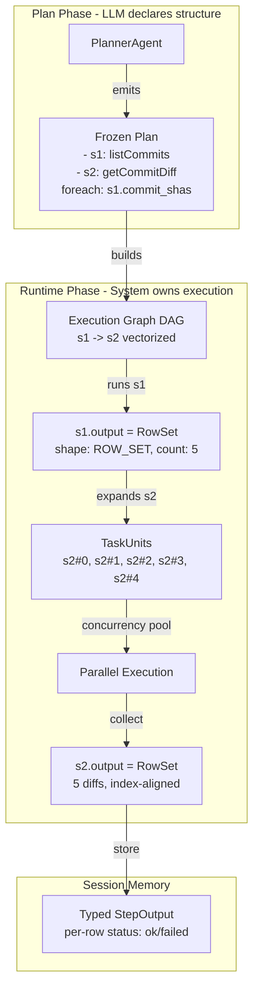

# OpenClaw Fan-Out Engine

## Architecture Overview

The LLM Planner declares structure. The Runtime owns execution. Skills are relational operators. `foreach` is a map. The Runtime is the query engine.




---

## Concrete Changes

### 1. New File: [Sidecar/app/services/execution_engine.py](Sidecar/app/services/execution_engine.py)

The centerpiece. Contains all runtime mechanics, completely separate from the planner.

**TemplateResolver** -- resolves `{{ var }}` (scalar item) and `{{ var.field }}` (object property). Two regex patterns, no Jinja dependency:

```python
import re

_TEMPLATE_RE = re.compile(r"\{\{\s*(\w+)(?:\.(\w+))?\s*\}\}")

def resolve_template(template: str, alias: str, item: Any) -> Any:
    """Resolve '{{ alias }}' or '{{ alias.field }}' against an item."""
    match = _TEMPLATE_RE.fullmatch(template.strip())
    if not match:
        return template  # literal passthrough
    var_name, field_name = match.groups()
    if var_name != alias:
        return template
    if field_name and isinstance(item, dict):
        return item.get(field_name, template)
    return item  # scalar
```

**ExecutionNode** -- wraps a plan step in the DAG:

```python
class ExecutionNode:
    step: PlanStepModel
    is_vectorized: bool  # True when step.foreach is set
    task_units: List[TaskUnit]  # empty until expansion
    status: str  # pending / running / completed / failed
```

**ExecutionGraph** -- built from the frozen plan:

- `from_plan(plan: ExecutionPlanModel) -> ExecutionGraph` -- walks steps, creates nodes, wires edges from `depends_on`
- `expand_foreach(node_id, row_set)` -- called after a dependency produces a RowSet; creates N TaskUnits for the vectorized node
- `get_ready_nodes()` -- returns nodes whose dependencies are all completed

**FanOutEngine** -- executes a vectorized node:

- Takes an `ExecutionNode` + the source `RowSet` + `OperationAgent`
- Creates task-scoped context per item using `resolve_template` on each `input_mapping`
- Runs task units with `asyncio.Semaphore(concurrency)` + `asyncio.gather`
- Collects results into a new `RowSet` with per-row `status: ok | failed`
- Failed tasks store the error string; successful ones store the output value

```python
async def execute_fan_out(
    self,
    node: ExecutionNode,
    source_row_set: RowSet,
    skill: Skill,
    base_context: ContextArtifactModel,
) -> RowSet:
    sem = asyncio.Semaphore(node.step.foreach.concurrency)
    tasks = []
    for i, row in enumerate(source_row_set.rows):
        tu = TaskUnit(task_id=f"{node.step.step_id}#{i}", ...)
        node.task_units.append(tu)
        tasks.append(self._run_one(tu, skill, base_context, node.step, row.value, sem))
    results = await asyncio.gather(*tasks, return_exceptions=True)
    return self._collect_row_set(node.step.step_id, node.task_units, results)
```

---

### 2. Schema Changes: [Sidecar/app/models/agent_schemas.py](Sidecar/app/models/agent_schemas.py)

**New models** (add after existing models, before Plugin section):

- `ForeachDirective` -- plan annotation, not executable logic:

```python
class ForeachDirective(BaseModel):
    source: str          # "s1.commit_shas" -> step_id.field_name
    as_name: str         # "commit" -- alias for current item
    concurrency: int = 5 # max parallel task units
```

- `RowStatus` enum: `ok`, `failed`, `pending`, `running`
- `RowResult` -- single row in a RowSet:

```python
class RowResult(BaseModel):
    index: int
    value: Optional[Any] = None
    error: Optional[str] = None
    status: RowStatus = RowStatus.PENDING
```

- `RowSet` -- typed container with index alignment:

```python
class RowSet(BaseModel):
    step_id: str
    field: str            # which output field this came from
    count: int = 0
    rows: List[RowResult] = Field(default_factory=list)
```

- `TaskUnit` -- individual fan-out execution unit:

```python
class TaskUnit(BaseModel):
    task_id: str          # "s2#0"
    parent_step_id: str   # "s2"
    index: int
    inputs: Dict[str, Any] = Field(default_factory=dict)
    status: RowStatus = RowStatus.PENDING
    retry_count: int = 0
```

- `StepOutput` -- shape-annotated output stored in session memory (replaces raw dict):

```python
class OutputShape(str, Enum):
    SCALAR = "scalar"
    ROW_SET = "row_set"

class StepOutput(BaseModel):
    step_id: str
    shape: OutputShape
    artifact: OutputArtifactModel          # scalar output or combined
    row_set: Optional[RowSet] = None       # present when shape == ROW_SET
```

**Modified models:**

- `PlanStepModel` -- add three fields:

```python
class PlanStepModel(BaseModel):
    # ... existing fields unchanged ...
    foreach: Optional[ForeachDirective] = None
    input_mappings: Dict[str, str] = Field(default_factory=dict)  # {"commit_sha": "{{ commit }}"}
    produces: Optional[str] = None  # "rows" -- hint for shape annotation
```

- `StepExecuteResponse` -- add RowSet to the response:

```python
class StepExecuteResponse(BaseModel):
    step_id: str
    output: Optional[OutputArtifactModel] = None
    row_set: Optional[RowSet] = None  # present for foreach steps
    status: str = "completed"
    error: Optional[str] = None
```

---

### 3. Planner Changes: [Sidecar/app/services/agent_service.py](Sidecar/app/services/agent_service.py) -- PlannerAgent

The LLM emits **structural metadata**, not loops. Two changes:

**a) Updated LLM prompt** in `_llm_select_skills` (around line 138):

The prompt currently asks for a bare JSON array of skill IDs. Update it to request extended objects when foreach is needed:

```
Return a JSON array of step objects. Each object has:
- "skill_id": the skill to run
- "foreach" (optional): { "source": "<step_id>.<field>", "as": "<alias>" }
  Use this when the previous skill returns an array and this skill should run per-item.
- "input_mappings" (optional): { "<param>": "{{ <alias> }}" or "{{ <alias>.<field> }}" }
  Maps iteration variable to skill input params. Only needed with foreach.

Example without foreach: [{"skill_id": "github.listCommits"}]
Example with foreach:
[
  {"skill_id": "github.listCommits"},
  {"skill_id": "github.getCommitDiff", "foreach": {"source": "listCommits.commit_shas", "as": "sha"}, "input_mappings": {"commit_sha": "{{ sha }}"}}
]
```

**b) Updated response parsing** in `_llm_select_skills`:

Parse the LLM response as `List[Dict]` instead of `List[str]`. Extract `foreach` and `input_mappings` from each entry. Attach them to the `SkillCandidate` (add a `plan_annotations` dict field or pass through to `_build_execution_plan`).

**c) Updated `_build_execution_plan**`:

When building `PlanStepModel`, propagate `foreach` and `input_mappings` from the LLM annotations onto the step. The plan is then frozen and stored.

---

### 4. Runtime Changes: [Sidecar/app/services/agent_service.py](Sidecar/app/services/agent_service.py) -- OperationAgent

`**execute_step` method** (line 426) gains a branch:

```python
async def execute_step(self, step, context) -> tuple[OutputArtifactModel, ContextArtifactModel, Optional[RowSet]]:
    skill = self.registry.get_skill(step.skill_id)

    if step.foreach:
        # Delegate to execution engine
        from app.services.execution_engine import FanOutEngine
        engine = FanOutEngine()
        source_row_set = self._resolve_source_row_set(context, step.foreach.source)
        row_set = await engine.execute_fan_out(node, source_row_set, skill, context)
        artifact = self._combine_row_set_artifact(row_set, skill)
        return artifact, context, row_set
    else:
        # Existing scalar path (unchanged)
        output_data = await self._execute_skill(skill, context)
        ...
        return artifact, context, None
```

**New helper `_resolve_source_row_set**`: Parses `"listCommits.commit_shas"` to find the step output from session memory, extracts the named field, wraps it as a `RowSet` with row handles.

**Output registration for scalar steps**: After a scalar skill runs, if any output field is an array, register it as a RowSet in session memory (shape annotation). This is step 3 from the OpenClaw design: "Stores output in session memory, annotates shape, registers row handles."

---

### 5. Session Memory Changes: [Sidecar/app/services/agent_service.py](Sidecar/app/services/agent_service.py) -- SessionStore

Update `step_outputs` to store `StepOutput` (typed with shape) instead of raw `OutputArtifactModel`:

```python
# In SessionStore.create_session:
"step_outputs": {}  # step_id -> StepOutput (with shape + optional RowSet)
```

When a step completes:

- SCALAR step: `StepOutput(shape=SCALAR, artifact=artifact)`
- Foreach step: `StepOutput(shape=ROW_SET, artifact=combined_artifact, row_set=row_set)`

The RowSet stores per-row status (`ok` / `failed` / `error`), enabling partial failures, retry of specific indices, and downstream filtering.

---

### 6. Route Changes: [Sidecar/app/routes/agent_routes.py](Sidecar/app/routes/agent_routes.py)

Update `execute_step` endpoint (line 135):

- Unpack the third return value (`row_set`) from `operation_agent.execute_step`
- Store `StepOutput` in session instead of raw artifact
- Return `row_set` in the `StepExecuteResponse`

The response for a foreach step looks like:

```json
{
  "step_id": "plan-123-step-1",
  "status": "completed",
  "output": { "artifact_id": "...", "type": "text", "display_type": "list", "data": [...] },
  "row_set": {
    "step_id": "plan-123-step-1",
    "field": "commit_shas",
    "count": 5,
    "rows": [
      { "index": 0, "value": { "diff_text": "...", "files_changed": [...] }, "status": "ok" },
      { "index": 1, "value": { "diff_text": "...", "files_changed": [...] }, "status": "ok" },
      { "index": 2, "error": "API rate limited", "status": "failed" },
      { "index": 3, "value": { "diff_text": "...", "files_changed": [...] }, "status": "ok" },
      { "index": 4, "value": { "diff_text": "...", "files_changed": [...] }, "status": "ok" }
    ]
  }
}
```

---

### 7. Swift Frontend: [Sources/Bowser/Models/AgentState.swift](Sources/Bowser/Models/AgentState.swift)

Minimal changes to consume the new response shape:

- `**AgentPlanStep**` -- add `isForeach: Bool` and `foreachSource: String?`, parsed from plan JSON `foreach` field
- `**OutputArtifact**` -- add optional `rowSet: RowSetData?` parsed from response `row_set` field
- `**parseExecutionPlan**` -- parse `foreach` from step JSON
- `**parseOutputArtifact**` -- parse `row_set` from response JSON if present

The UI rendering of RowSet data (e.g., showing 5 diffs in tabs or an accordion) is a separate concern and not part of this plan.

---

## Execution Flow (Concrete Example)

**Query**: "get diff for last 5 commits on owner/repo"

1. `**/plan**` -- PlannerAgent emits frozen plan:
  - `s1: github.listCommits` (produces `commit_shas`)
  - `s2: github.getCommitDiff`, `foreach: { source: "s1.commit_shas", as: "sha" }`, `input_mappings: { "commit_sha": "{{ sha }}" }`
2. `**/context**` -- Client provides `repo: "owner/repo"`, `github_token: "ghp_..."`
3. `**/execute-step` for s1** -- `listCommits` runs, returns 5 commits. Runtime:
  - Stores `StepOutput(shape=ROW_SET)` with `commit_shas` as a RowSet of 5 handles
  - Merges scalar fields into context as before
4. `**/execute-step` for s2** -- Runtime sees `foreach`:
  - Resolves `s1.commit_shas` from session memory -> RowSet with 5 items
  - Expands into 5 TaskUnits: `s2#0(sha=abc)`, `s2#1(sha=def)`, ...
  - Runs with `asyncio.Semaphore(5)` + `asyncio.gather`
  - Collects 5 results into `RowSet(count=5, rows=[...])`
  - Returns combined artifact + RowSet in response

---

## Key Invariants

- The LLM never sees or decides cardinality -- it only declares `foreach` structure
- The plan is frozen after `/plan` -- no mutations
- Fan-out expansion happens in the runtime, after the source step completes
- Each TaskUnit has its own lifecycle, retries, and can fail independently
- Index alignment is preserved through RowResult.index
- Session memory stores typed StepOutput with per-row status

