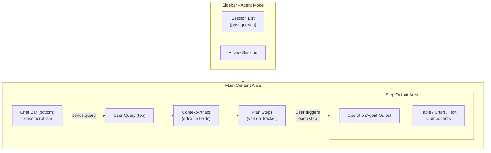
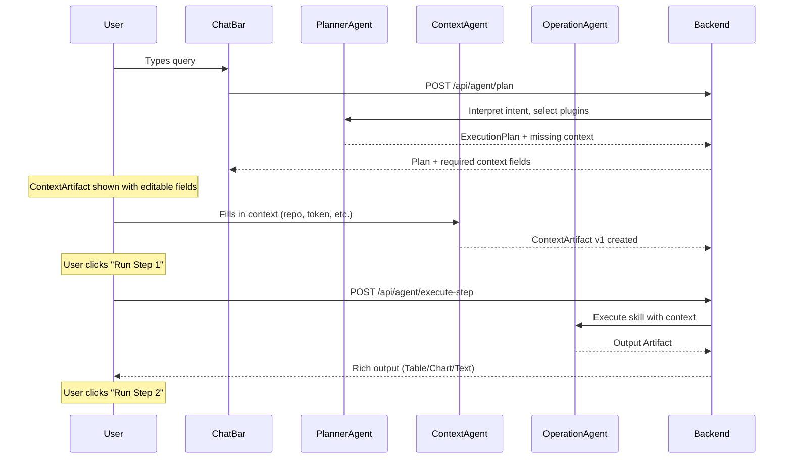
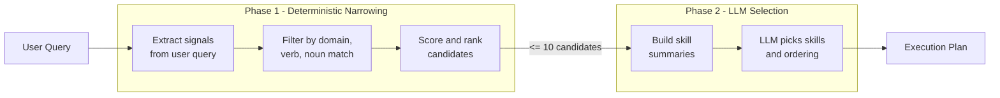

# Agent Mode UI Implementation Plan

## Architecture Overview

Agent Mode adds a third panel mode (`.agent`) to Bowser. When active:

- **Sidebar**: Shows a minimal list of past agent sessions (like a chat history list) + a "New Session" button
- **Main Content Area**: Replaces the web canvas with the agent execution UI -- query at top, editable context artifact, step-by-step plan execution with outputs
- **Chat Bar**: Glassmorphism-styled input bar pinned to the bottom of the main view




## Data Flow




---

## Part 1: Swift UI Layer

### 1.1 Extend PanelMode enum

**File**: `[Sources/Bowser/BrowserState.swift](Sources/Bowser/BrowserState.swift)`

Add `.agent` case to the existing enum:

```swift
enum PanelMode: String, Codable {
    case tab
    case plan
    case agent  // NEW
}
```

Add `agentState` property to `BrowserState`:

```swift
var agentState: AgentState = AgentState()
```

### 1.2 Create AgentState model

**New file**: `Sources/Bowser/Models/AgentState.swift`

Core state model for agent mode, following the `PlanState` pattern (`@Observable`, `@MainActor`):

- `AgentSession` -- one execution session (id, query, contextArtifact, executionPlan, stepOutputs, status, timestamp)
- `ContextArtifact` -- versioned, editable fields: `values: [String: ContextValue]`, `auth: [String: AuthEntry]`, `version: Int`
- `ContextValue` -- field with `name`, `description`, `value`, `required`, `fieldType` (string/number/boolean/secret)
- `AuthEntry` -- `strategyUsed` (token/user_password), `value`, `valid`
- `ExecutionPlan` -- `planId`, `steps: [AgentPlanStep]`
- `AgentPlanStep` -- `stepId`, `agentType`, `pluginId`, `skillId`, `status` (pending/running/completed/failed), `outputArtifact`
- `OutputArtifact` -- `artifactId`, `type`, `displayType` (table/chart/text/list/custom), `data: Any`, `timestamp`
- `sessions: [AgentSession]` -- session history for sidebar
- `currentSession: AgentSession?` -- active session
- API methods: `submitQuery()`, `updateContext()`, `executeStep()`, `createNewSession()`

### 1.3 Update sidebar toggle

**File**: `[Sources/Bowser/Views/SidebarHeaderView.swift](Sources/Bowser/Views/SidebarHeaderView.swift)`

Add a third "Agent" button to `panelModeToggle` (lines 133-169). The three buttons (Tab, Plan, Agent) will be arranged in the existing HStack segmented control pattern. Use SF Symbol `cpu` or `wand.and.stars` for the Agent icon.

### 1.4 Update sidebar content switching

**File**: `[Sources/Bowser/Views/Shell/ArcSidebarView.swift](Sources/Bowser/Views/Shell/ArcSidebarView.swift)`

Update the panel content switch (lines 151-155) to add the agent case:

```swift
switch browserState.currentPanelMode {
case .tab:
    tabListSection
case .plan:
    PlanModeView(browserState: browserState)
case .agent:
    AgentSessionListView(browserState: browserState)  // NEW
}
```

### 1.5 Create AgentSessionListView (Sidebar)

**New file**: `Sources/Bowser/Views/AgentSessionListView.swift`

Minimal sidebar view showing:

- "New Session" button at top
- List of past sessions with query preview, timestamp, status indicator
- Tapping a session loads it as the current session
- Follows the same visual style as `PlanListView`

### 1.6 Create AgentModeMainView (Main Content)

**New file**: `Sources/Bowser/Views/AgentModeMainView.swift`

The primary view displayed in the detail pane (replacing web canvas) when agent mode is active. Structure:

```
+----------------------------------------------+
| User Query (displayed at top, read-only)      |
+----------------------------------------------+
| ContextArtifact (editable form fields)        |
|  - repo: [________]                           |
|  - github_token: [****] (secret field)        |
|  - limit: [5]                                 |
|  [Save Context]                               |
+----------------------------------------------+
| Execution Plan Steps                          |
|  [1] ContextAgent - Collect Context  [done]   |
|  [2] github.listCommits             [Run ->]  |
|  [3] github.getCommitDiff           [pending] |
+----------------------------------------------+
| Step Output Area                              |
|  (Table / Chart / Text components)            |
+----------------------------------------------+
```

Composed of sub-views:

- `AgentQueryHeaderView` -- shows the query text
- `ContextArtifactView` -- editable form for all context fields
- `AgentPlanStepsView` -- vertical step tracker with manual "Run" buttons
- `AgentStepOutputView` -- renders OperationAgent output using UILibrary components

### 1.7 Create AgentChatBarView (Bottom Chat Input)

**New file**: `Sources/Bowser/Views/AgentChatBarView.swift`

Glassmorphism-styled chat bar pinned to bottom of main view:

- Uses `.ultraThinMaterial` background for glass effect
- Rounded corners, subtle border with `Color.white.opacity(0.2)`
- Text field + send button
- On submit: creates a new session or sends follow-up to current session
- Style reference: same material/blur approach as `UnifiedBackdropView`

### 1.8 Create ContextArtifactView

**New file**: `Sources/Bowser/Views/ContextArtifactView.swift`

Editable form for ContextArtifact fields:

- Each field rendered based on `fieldType`: text input, number stepper, toggle, secure field (for tokens/passwords)
- Version indicator ("v1", "v2") showing context history
- "Save" button creates a new context version
- Auth section with strategy selector (token or user/password for V1)
- Visual style: card with subtle background, consistent with existing component styling

### 1.9 Create AgentPlanStepsView

**New file**: `Sources/Bowser/Views/AgentPlanStepsView.swift`

Vertical step tracker (Shoreline-style):

- Each step shows: step number, agent type icon, skill name, status badge
- Status states: `pending` (gray), `running` (blue pulse), `completed` (green check), `failed` (red x)
- "Run" button only enabled on the next pending step (sequential execution)
- Completed steps show a summary of their output artifact
- Clicking a completed step scrolls to its output in the output area

### 1.10 Create AgentStepOutputView

**New file**: `Sources/Bowser/Views/AgentStepOutputView.swift`

Renders OperationAgent output artifacts using UILibrary components. Wraps the output based on `displayType` to select the right component.

### 1.11 Update FloatingWebCanvasView

**File**: `[Sources/Bowser/Views/Shell/FloatingWebCanvasView.swift](Sources/Bowser/Views/Shell/FloatingWebCanvasView.swift)`

Add agent mode check alongside the existing generative UI mode check (line 83):

```swift
let isAgentMode = browserState.currentPanelMode == .agent
```

When `isAgentMode`, render `AgentModeMainView` instead of the web canvas.

---

## Part 2: New UILibrary Components

### 2.1 TableComponent

**New file**: `Sources/Bowser/Views/UILibrary/TableComponent.swift`

Reusable table for structured data:

- Column headers, sortable columns, alternating row backgrounds
- Data model: `TableData` with `columns: [TableColumn]` and `rows: [[String]]`
- Skeleton loader state
- Glassmorphism card background

### 2.2 ChartComponent

**New file**: `Sources/Bowser/Views/UILibrary/ChartComponent.swift`

Chart visualization using Swift Charts framework:

- Supports bar chart, line chart, pie chart
- Data model: `ChartData` with `chartType`, `labels`, `datasets`
- Skeleton loader state
- Auto-adapts to data shape

### 2.3 TextBlockComponent

**New file**: `Sources/Bowser/Views/UILibrary/TextBlockComponent.swift`

Rich text/markdown block for agent text output:

- Supports plain text, formatted text, code blocks
- Data model: `TextBlockData` with `content`, `format` (plain/markdown/code)
- Monospaced font for code, proportional for prose
- Copy button

### 2.4 ListComponent

**New file**: `Sources/Bowser/Views/UILibrary/ListComponent.swift`

Simple key-value or bullet list for structured output:

- Data model: `ListData` with `items: [ListItem]` (label + value pairs)
- Numbered or bulleted styles

### 2.5 Update UIComponentRegistry

**File**: `[Sources/Bowser/Views/UILibrary/UIComponentRegistry.swift](Sources/Bowser/Views/UILibrary/UIComponentRegistry.swift)`

Add new component types to `UIComponentType` enum and register metadata:

- `.table`, `.chart`, `.textBlock`, `.list`

---

## Part 3: Python Backend

### 3.1 Agent execution routes

**New file**: `Sidecar/app/routes/agent_routes.py`

Endpoints following the existing route pattern (Pydantic models, `ai_agent` import):


| Endpoint                       | Purpose                                                           |
| ------------------------------ | ----------------------------------------------------------------- |
| `POST /api/agent/plan`         | Takes user query, returns ExecutionPlan + required context fields |
| `POST /api/agent/context`      | Saves/updates ContextArtifact, returns new version                |
| `POST /api/agent/execute-step` | Executes a single plan step, returns output artifact              |
| `GET /api/agent/sessions`      | Lists past sessions                                               |
| `GET /api/agent/session/{id}`  | Gets a specific session                                           |


### 3.2 Agent service layer

**New file**: `Sidecar/app/services/agent_service.py`

Implements the three agents from the design doc:

- **PlannerAgent**: Takes user query, runs two-phase skill discovery (see 3.3), then calls LLM with selected skills to generate execution plan. Identifies missing context fields and auth requirements. If no suitable skills found, returns a clarification request to ContextAgent.
- **ContextAgent**: Validates context completeness, creates versioned ContextArtifacts
- **OperationAgent**: Executes a single skill using context, calls LLM with tools, produces typed output artifact with `displayType` for UI rendering

### 3.3 Skill Registry with Discovery

**New file**: `Sidecar/app/services/skill_registry.py`

Central registry with metadata-indexed lookup. This is the core of the skill discovery system.

**Skill Metadata** -- every skill MUST declare:

- `domains: list[str]` -- e.g. `["github", "version-control", "code"]`
- `verbs: list[str]` -- e.g. `["list", "fetch", "get"]`
- `nouns: list[str]` -- e.g. `["commits", "pull-requests", "repository"]`
- `output_types: list[str]` -- e.g. `["table", "list", "text"]`

**SkillRegistry class**:

```python
class SkillRegistry:
    def register_plugin(plugin: Plugin) -> None
    def lookup(
        domains: list[str] = None,
        verbs: list[str] = None,
        nouns: list[str] = None,
        output_types: list[str] = None,
        auth_available: list[str] = None,
        max_results: int = 10
    ) -> list[SkillCandidate]
    def get_all_domains() -> list[str]
    def get_skill(skill_id: str) -> Skill
```

**Two-phase discovery** (called by PlannerAgent):




**Phase 1 -- Deterministic Narrowing (non-LLM)**:

1. Extract intent signals from user input using simple NLP (keyword extraction, verb/noun identification via regex + stopword removal -- no LLM call)
2. Query `SkillRegistry.lookup()` with extracted domains, verbs, nouns
3. Apply hard filters: domain match, output compatibility, auth availability
4. Score candidates by metadata overlap (domain match = 3pts, verb match = 2pts, noun match = 1pt)
5. Return top 10 candidates max

**Phase 2 -- LLM Selection (small set only)**:

1. Build compact summaries of candidate skills (id, name, description, input/output types)
2. Call LLM with user intent + candidate summaries only (LLM NEVER sees full catalog)
3. LLM returns selected skills and execution ordering
4. If LLM finds no suitable match, PlannerAgent asks ContextAgent for user clarification

### 3.4 V1 Plugins

**New file**: `Sidecar/app/services/plugins/` (directory with per-plugin files)

Each plugin file registers skills with full metadata:

- `**github_plugin.py**` -- GitHub Plugin
  - Skills: `listCommits`, `getCommitDiff`, `listPRs`
  - Domains: `["github", "version-control", "git", "code"]`
  - Auth: token, user_password
- `**http_plugin.py**` -- Generic HTTP Plugin
  - Skills: `fetchURL`, `postRequest`
  - Domains: `["http", "web", "api"]`
  - Auth: optional token
- `**text_analysis_plugin.py**` -- Text Analysis Plugin
  - Skills: `summarize`, `extractEntities`, `compare`
  - Domains: `["text", "analysis", "nlp"]`
  - Auth: none

### 3.5 Pydantic models for agent mode

**New file**: `Sidecar/app/models/agent_schemas.py`

Request/response models:

- `PlanRequest`, `PlanResponse` (execution plan)
- `ContextUpdateRequest`, `ContextUpdateResponse`
- `StepExecuteRequest`, `StepExecuteResponse` (includes `displayType` and `data`)
- `AgentSessionSummary`, `AgentSessionDetail`
- `ContextArtifactModel`, `PlanStepModel`, `OutputArtifactModel`

Skill discovery models:

- `SkillMetadata` -- `skill_id`, `plugin_id`, `name`, `description`, `domains`, `verbs`, `nouns`, `output_types`, `input_schema`
- `SkillCandidate` -- `skill: SkillMetadata`, `score: float`, `match_reasons: list[str]`
- `SkillDiscoveryResult` -- `candidates: list[SkillCandidate]`, `extracted_signals: dict` (domains, verbs, nouns found in query)

### 3.6 Register routes in main.py

**File**: `[Sidecar/app/main.py](Sidecar/app/main.py)`

Add:

```python
app.include_router(agent_routes.router, prefix="/api/agent", tags=["Agent"])
```

---

## Part 4: Wiring

### 4.1 AgentState API methods

Wire `AgentState` methods to call the Python backend at `http://localhost:8765/api/agent/...` using `URLSession` async/await, following the same pattern as `PlanState`'s API calls.

### 4.2 JSON schemas for new UILibrary components

**New files** in `Sources/Bowser/Views/UILibrary/Schemas/`:

- `table.schema.json`
- `chart.schema.json`
- `textBlock.schema.json`
- `list.schema.json`

These are read by the Python backend for LLM schema validation.

---

## File Summary

**New Swift files (11):**

- `Sources/Bowser/Models/AgentState.swift`
- `Sources/Bowser/Views/AgentSessionListView.swift`
- `Sources/Bowser/Views/AgentModeMainView.swift`
- `Sources/Bowser/Views/AgentChatBarView.swift`
- `Sources/Bowser/Views/ContextArtifactView.swift`
- `Sources/Bowser/Views/AgentPlanStepsView.swift`
- `Sources/Bowser/Views/AgentStepOutputView.swift`
- `Sources/Bowser/Views/UILibrary/TableComponent.swift`
- `Sources/Bowser/Views/UILibrary/ChartComponent.swift`
- `Sources/Bowser/Views/UILibrary/TextBlockComponent.swift`
- `Sources/Bowser/Views/UILibrary/ListComponent.swift`

**Modified Swift files (5):**

- `Sources/Bowser/BrowserState.swift` -- add `.agent` case, `agentState` property
- `Sources/Bowser/Views/SidebarHeaderView.swift` -- third toggle button
- `Sources/Bowser/Views/Shell/ArcSidebarView.swift` -- agent mode branch
- `Sources/Bowser/Views/Shell/FloatingWebCanvasView.swift` -- agent mode branch
- `Sources/Bowser/Views/UILibrary/UIComponentRegistry.swift` -- new component types

**New Python files (7):**

- `Sidecar/app/routes/agent_routes.py`
- `Sidecar/app/services/agent_service.py`
- `Sidecar/app/services/skill_registry.py` -- SkillRegistry with metadata-indexed lookup and two-phase discovery
- `Sidecar/app/services/plugins/github_plugin.py`
- `Sidecar/app/services/plugins/http_plugin.py`
- `Sidecar/app/services/plugins/text_analysis_plugin.py`
- `Sidecar/app/models/agent_schemas.py`

**Modified Python files (1):**

- `Sidecar/app/main.py` -- register agent routes

**New JSON schema files (4):**

- `Sources/Bowser/Views/UILibrary/Schemas/table.schema.json`
- `Sources/Bowser/Views/UILibrary/Schemas/chart.schema.json`
- `Sources/Bowser/Views/UILibrary/Schemas/textBlock.schema.json`
- `Sources/Bowser/Views/UILibrary/Schemas/list.schema.json`

