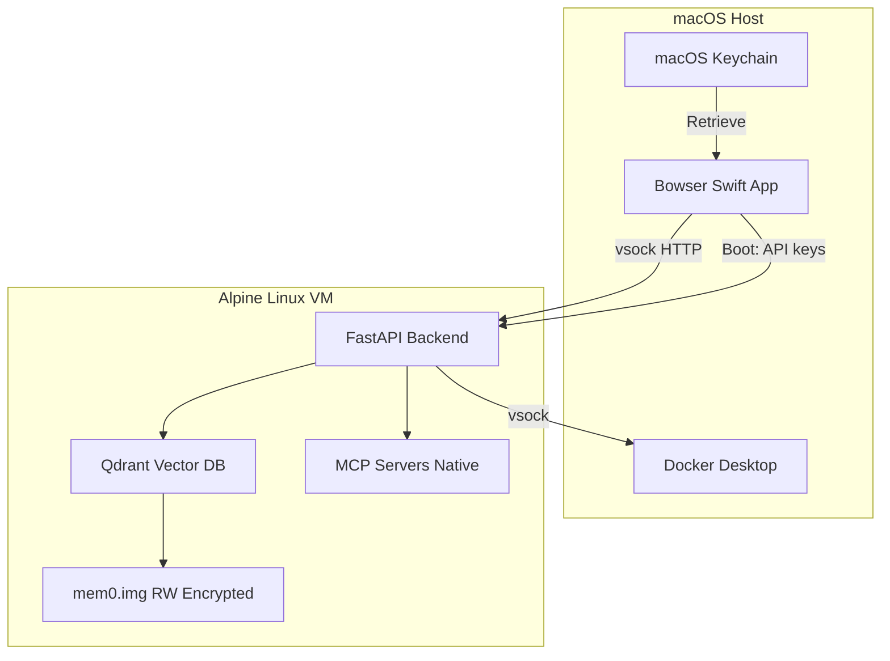
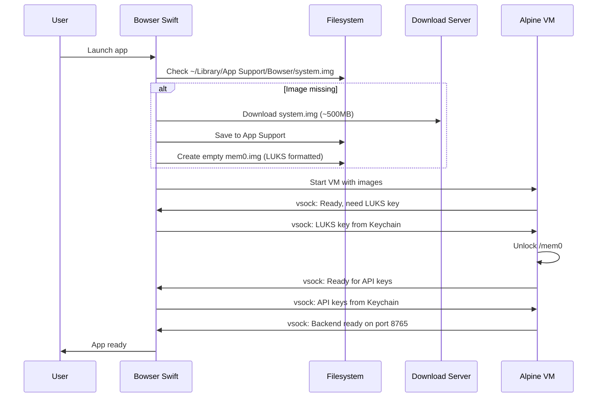

# Linux VM Backend Sandbox

## Architecture Overview




## Design Decisions Summary


| Decision       | Choice                                                                         |
| -------------- | ------------------------------------------------------------------------------ |
| IPC Protocol   | HTTP over vsock (keep FastAPI, change transport)                               |
| Encryption     | LUKS (key from macOS Keychain via vsock at boot)                               |
| VM Lifecycle   | Start with app, stop on quit                                                   |
| API Keys       | User enters in Swift UI -> Keychain -> passed to VM at session start via vsock |
| Python Runtime | uv with frozen lockfile (fast, reproducible)                                   |
| Image Updates  | Full image replacement on app update                                           |
| MCP            | Native in Alpine + Docker MCP Gateway on host via vsock                        |
| Playwright     | Remove (not used)                                                              |
| VM Packaging   | Download on first launch to `~/Library/Application Support/Bowser/`          |


## VM Specification

```yaml
Hypervisor: Apple Virtualization.framework
Guest_OS: Alpine Linux 3.19 (musl-based, minimal)
CPU: 2 vCPUs
RAM: 2-4 GB (configurable)
Disks:
  system.img: 
    size: ~500MB
    mode: read-only
    contents: Alpine + Python + uv venv + app code
  mem0.img:
    size: 1-5GB (growable)
    mode: read-write
    encryption: LUKS2
    mount: /mem0 (rw,noexec)
    contents: Qdrant data, user memories
Mounts:
  /: read-only (system.img)
  /mem0: rw,noexec (mem0.img)
  /tmp: tmpfs (ephemeral)
Network: vsock only (no TCP/IP)
```

## Implementation

### Phase 1: Swift VM Manager

Create `[Sources/Bowser/VM/VMManager.swift](Sources/Bowser/VM/VMManager.swift)`:

```swift
// Key responsibilities:
// - Create/configure VZVirtualMachine with Virtualization.framework
// - Manage vsock device for IPC
// - Handle VM lifecycle (start/stop with app)
// - Pass LUKS key and API keys at boot via vsock
```

Key classes:

- `VMManager`: Singleton managing VM lifecycle
- `VSockConnection`: HTTP client over vsock (port 8765)
- `VMBootstrap`: Handles first-launch image download

### Phase 2: Alpine Linux Image Build

Create `[VM/build-image.sh](VM/build-image.sh)`:

```bash
# Build reproducible Alpine image with:
# - Python 3.12 + uv
# - Frozen venv from Sidecar/requirements.txt (minus playwright)
# - Init system (OpenRC or direct PID 1)
# - vsock HTTP server setup
# - LUKS tools for encrypted mount
```

Output: `system.img` (~500MB)

### Phase 3: vsock HTTP Transport

Modify `[Sidecar/app/main.py](Sidecar/app/main.py)`:

```python
# In VM mode:
# - Listen on vsock instead of TCP
# - Use hypercorn with vsock support or custom ASGI server
# - Receive LUKS key on boot, unlock /mem0
# - Receive API keys, store in memory only
```

### Phase 4: Dev/Production Mode Switch

Update `[run_dev.sh](run_dev.sh)`:

- Keep current behavior (direct Python process on macOS)
- No changes needed for dev workflow

Update `[build_app.sh](build_app.sh)`:

- Bundle VM bootstrap code
- First-launch downloads `system.img` + creates empty `mem0.img`
- Production app uses VM exclusively

### Phase 5: MCP Docker Gateway Bridge

Create vsock proxy for Docker MCP Gateway:

```
[FastAPI in VM] --vsock--> [Swift proxy] --stdio--> [docker mcp gateway run]
```

Swift acts as bridge between VM and Docker on host.

## File Structure

```
Sources/Bowser/
├── VM/
│   ├── VMManager.swift          # VM lifecycle management
│   ├── VSockClient.swift        # HTTP-over-vsock client
│   ├── VMBootstrap.swift        # First-launch image download
│   └── VMConfiguration.swift    # CPU/RAM/disk settings

VM/
├── build-image.sh               # Alpine image builder
├── alpine/
│   ├── init                     # PID 1 init script
│   ├── start-backend.sh         # Launch FastAPI on vsock
│   └── unlock-storage.sh        # LUKS unlock helper
├── Dockerfile.build             # For reproducible builds
└── requirements-vm.txt          # Sidecar deps minus playwright

Sidecar/app/
├── main.py                      # Add vsock listener mode
└── vsock_transport.py           # vsock ASGI transport
```

## Security Model

1. **Network Isolation**: VM has no TCP/IP, only vsock to host
2. **Filesystem Isolation**: Root is read-only, only /mem0 writable
3. **No Exec on Data**: /mem0 mounted with noexec
4. **Encrypted at Rest**: User data in LUKS, key never persists in VM
5. **API Keys in Memory**: Passed at boot, stored in tmpfs only
6. **Process Isolation**: Full VM boundary, not just container

## First-Launch Flow




