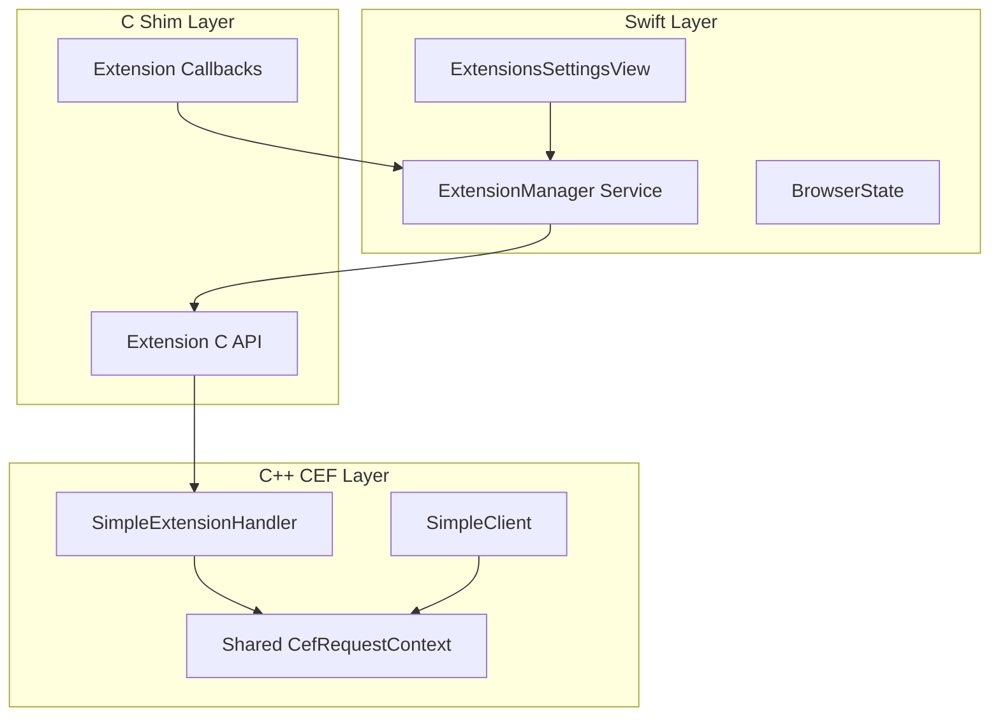

# Chrome Extension Support Implementation

## Architecture Overview




## Key Implementation Files

### C++ Layer ([shim_impl.cpp](Sources/CEFWrapper/shim_impl.cpp))

1. **Create `SimpleExtensionHandler` class** implementing `CefExtensionHandler`:
  - `OnExtensionLoaded` - Track loaded extensions, notify Swift
  - `OnExtensionLoadFailed` - Report errors to Swift
  - `OnExtensionUnloaded` - Clean up, notify Swift
  - `OnBeforeBackgroundBrowser` - Allow background script browsers (return false)
  - `OnBeforeBrowser` - Allow extension popup/option browsers (return false)
  - `GetActiveBrowser` - Return current active browser for tabs API
  - `CanAccessBrowser` - Return true to grant all permissions (as requested)
  - `GetExtensionResource` - Return false for default disk-based loading
2. **Create shared `CefRequestContext**` with extension support:
  - Stored as global `g_request_context`
  - Created during `cef_simple_initialize_with_path()` 
  - Shared across all browser instances (line ~1292)
3. **Extension data storage**:
  - `ExtensionInfo` struct: id, name, version, description, path, icon, optionsUrl, enabled
  - `g_extensions` map storing loaded extension info

### C Shim API ([cef_shim.h](Sources/CEFWrapper/include/cef_shim.h))

Add new C functions:

```c
// Extension Management
void cef_load_extension(const char* path);
void cef_unload_extension(const char* extension_id);
int cef_get_extension_count();
const char* cef_get_extension_info_json();  // Returns JSON array of extensions

// Extension Callbacks
typedef void (*CefExtensionLoadedCallback)(const char* extension_json);
typedef void (*CefExtensionLoadFailedCallback)(const char* path, int error_code);
typedef void (*CefExtensionUnloadedCallback)(const char* extension_id);
void cef_register_extension_callbacks(...);
```

### Swift Service Layer

**New file: [ExtensionManager.swift**](Sources/Bowser/Services/ExtensionManager.swift)

```swift
@Observable
@MainActor
final class ExtensionManager {
    var extensions: [ExtensionInfo] = []
    
    func loadExtension(from path: URL) async
    func unloadExtension(id: String)
    func refreshExtensions()
    func openOptionsPage(for extension: ExtensionInfo)
}
```

**Model: [ExtensionInfo.swift**](Sources/Bowser/Models/ExtensionInfo.swift)

```swift
struct ExtensionInfo: Identifiable, Codable {
    let id: String
    var name: String
    var version: String
    var description: String
    var path: String
    var iconPath: String?
    var optionsUrl: String?
    var isEnabled: Bool
}
```

### Swift UI Layer

**New file: [ExtensionsSettingsView.swift**](Sources/Bowser/Views/Settings/ExtensionsSettingsView.swift)

Features:

- List of installed extensions with icon, name, version, description
- Toggle to enable/disable each extension
- "Options" button (opens extension's options page in new tab)
- "Remove" button to uninstall
- "Load Unpacked" button to install from folder
- Drag-and-drop .crx/.zip file support (future)

**Update: [SettingsView.swift**](Sources/Bowser/Views/SettingsView.swift)

Add `extensions` case to `SettingsCategory` enum with puzzle.piece icon.

### Extension Options Page Flow

When user clicks "Options":

1. `ExtensionManager.openOptionsPage(extension)` called
2. Get options URL from extension manifest: `chrome-extension://{id}/options.html`
3. Call `BrowserState.createTab(url: optionsURL)`
4. Navigate to the options page in new tab

## Installation Workflow

1. User clicks "Load Unpacked Extension..."
2. `NSOpenPanel` opens to select extension folder
3. Validate folder contains `manifest.json`
4. Call `cef_load_extension(path)`
5. CEF loads extension, triggers `OnExtensionLoaded` callback
6. Swift receives callback, parses extension info, updates UI
7. Extension persisted in UserDefaults for reload on app launch

## Persistence

- Store list of extension paths in UserDefaults
- On app launch, re-load all persisted extensions via `cef_load_extension()`
- Extensions stored in `~/Library/Application Support/Bowser/Extensions/`

## Key CEF API Usage

```cpp
// Load extension from disk
CefRefPtr<CefRequestContext> ctx = CefRequestContext::GetGlobalContext();
ctx->LoadExtension(
    root_directory,  // Absolute path to extension folder
    nullptr,         // manifest (nullptr = read from disk)
    extension_handler
);

// Get extension list
std::vector<CefString> extension_ids;
ctx->GetExtensions(extension_ids);

// Get specific extension
CefRefPtr<CefExtension> ext = ctx->GetExtension(extension_id);
std::string name = ext->GetIdentifier();
CefRefPtr<CefDictionaryValue> manifest = ext->GetManifest();

// Unload extension
ext->Unload();
```

