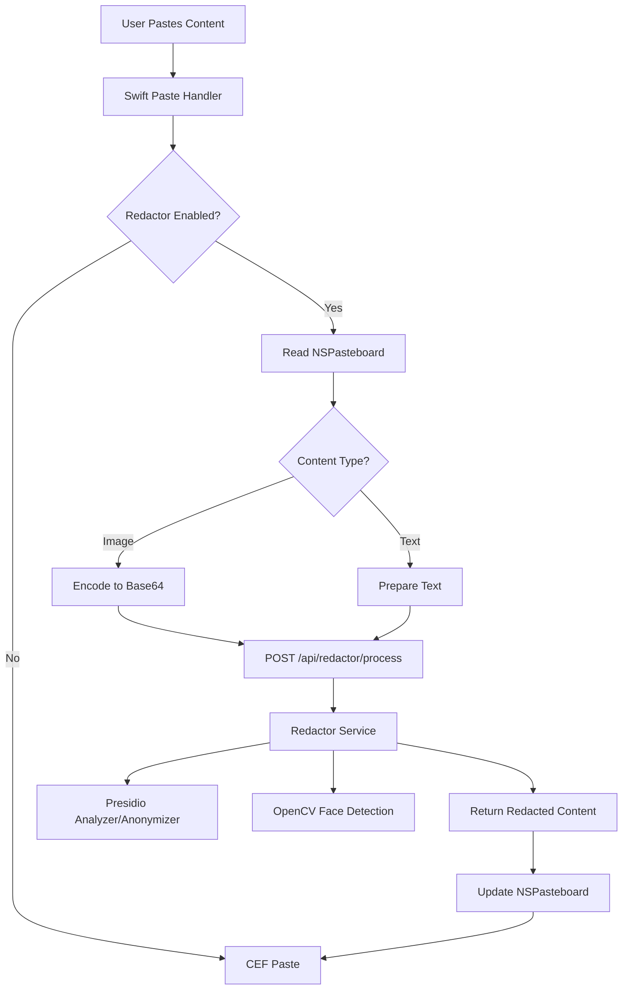

# Redactor Feature Integration Plan

## Overview

Implement automatic redaction of sensitive content (faces in images, PII in text) when pasting anywhere in Bowser. The feature will be toggleable from Privacy & Security settings and will use the existing redactor.py implementation integrated into the Sidecar backend.

## Architecture

## Implementation Steps

### 1. Backend Service Integration

**Add redactor endpoint to Sidecar** (`[Sidecar/app/routes/redactor_routes.py](Sidecar/app/routes/redactor_routes.py)` - new file):

- Create FastAPI router with `/api/redactor/process` endpoint
- Accept JSON payload: `{"type": "text" | "image", "content": string}`
- For images: expect base64 data URL format
- For text: plain text string
- Return: `{"type": "text" | "image", "content": redacted_content}`

**Integrate redactor.py logic** (`[Sidecar/app/services/redactor_service.py](Sidecar/app/services/redactor_service.py)` - new file):

- Port the redactor.py functions to a service class
- Initialize Presidio engines and OpenCV face cascade on service startup
- Methods: `process_image(base64_str) -> str`, `process_text(text) -> str`
- Handle errors gracefully, return original content if redaction fails

**Update dependencies** (`[Sidecar/requirements.txt](Sidecar/requirements.txt)`):

- Add `opencv-python>=4.8.0`
- Add `presidio-analyzer>=2.2.0`
- Add `presidio-anonymizer>=2.2.0`

**Register router** (`[Sidecar/app/main.py](Sidecar/app/main.py)`):

- Import and include redactor router: `app.include_router(redactor_routes.router, prefix="/api/redactor", tags=["Redactor"])`

### 2. Settings Integration

**Add redactor setting** (`[Sources/Bowser/Services/SettingsManager.swift](Sources/Bowser/Services/SettingsManager.swift)`):

- Add storage key: `static let redactorEnabled = "bowser.settings.redactorEnabled"`
- Add property: `var redactorEnabled: Bool` with `didSet` observer
- Initialize from UserDefaults in `init()`, default to `false`

**Add UI toggle** (`[Sources/Bowser/Views/Settings/PrivacySettingsView.swift](Sources/Bowser/Views/Settings/PrivacySettingsView.swift)`):

- Add new section "Content Redaction" after "Site Permissions"
- Add toggle: `Toggle("Automatically redact sensitive content when pasting", isOn: $manager.redactorEnabled)`
- Add help text explaining face blurring and PII redaction

### 3. Swift Redactor Service

**Create RedactorService** (`[Sources/Bowser/Services/RedactorService.swift](Sources/Bowser/Services/RedactorService.swift)` - new file):

- Singleton service to communicate with backend redactor endpoint
- Method: `redactClipboardContent() async throws -> Bool`
  - Read NSPasteboard for images (types: `.png`, `.tiff`, `.jpeg`) and text (`.string`)
  - Convert image to base64 data URL if present
  - Send to backend `/api/redactor/process`
  - Update NSPasteboard with redacted content
  - Return true if redaction occurred, false if skipped
- Method: `redactImage(_ data: Data) async throws -> Data`
- Method: `redactText(_ text: String) async throws -> String`
- Handle errors: log and return original content on failure

### 4. Paste Interception

**Modify paste handler** (`[Sources/Bowser/AppDelegate.swift](Sources/Bowser/AppDelegate.swift)`):

- Update `handlePaste()` method (line 602):
  - Check `browserState.settingsManager.redactorEnabled`
  - If enabled, call `RedactorService.shared.redactClipboardContent()` before `BrowserManager.shared.paste()`
  - Use `Task { await ... }` for async call
  - Show subtle indicator (optional) during redaction processing

**Alternative: Modify BrowserManager** (`[Sources/Bowser/Services/BrowserManager.swift](Sources/Bowser/Services/BrowserManager.swift)`):

- Update `paste(pageId:)` method (line 276) to call redactor service
- This ensures redaction works even if paste is triggered programmatically

### 5. CEF Web Content Paste Handling

**Challenge**: CEF's `frame->Paste()` directly accesses system clipboard. We need to intercept BEFORE CEF reads it.

**Solution**: Modify NSPasteboard before CEF access:

- In `handlePaste()`, redact clipboard content synchronously
- CEF will then read the already-redacted content from NSPasteboard
- This works for both Swift UI and CEF web content

### 6. Error Handling & UX

**Graceful degradation**:

- If backend is unavailable, log error and paste original content
- If redaction fails, paste original content (don't block user)
- Add timeout (5 seconds) for redaction API call

**User feedback** (optional enhancement):

- Show subtle progress indicator during redaction
- Toast notification: "Content redacted" (dismisses automatically)

## Data Flow Example

**Text paste:**

1. User presses CMD+V with text in clipboard
2. `handlePaste()` checks `redactorEnabled` → true
3. Read NSPasteboard: `"My SSN is 123-45-6789"`
4. POST to `/api/redactor/process`: `{"type": "text", "content": "My SSN is 123-45-6789"}`
5. Backend returns: `{"type": "text", "content": "My SSN is <SSN>"}`
6. Update NSPasteboard with redacted text
7. Call `BrowserManager.shared.paste()` → CEF pastes redacted text

**Image paste:**

1. User presses CMD+V with image in clipboard
2. `handlePaste()` checks `redactorEnabled` → true
3. Read NSPasteboard image → convert to base64 data URL
4. POST to `/api/redactor/process`: `{"type": "image", "content": "data:image/png;base64,..."}`
5. Backend detects faces, applies Gaussian blur, returns blurred image as data URL
6. Convert base64 back to image data, update NSPasteboard
7. Call `BrowserManager.shared.paste()` → CEF pastes redacted image

## Files to Create

1. `[Sidecar/app/routes/redactor_routes.py](Sidecar/app/routes/redactor_routes.py)` - FastAPI router
2. `[Sidecar/app/services/redactor_service.py](Sidecar/app/services/redactor_service.py)` - Redaction logic
3. `[Sources/Bowser/Services/RedactorService.swift](Sources/Bowser/Services/RedactorService.swift)` - Swift client

## Files to Modify

1. `[Sidecar/requirements.txt](Sidecar/requirements.txt)` - Add dependencies
2. `[Sidecar/app/main.py](Sidecar/app/main.py)` - Register router
3. `[Sources/Bowser/Services/SettingsManager.swift](Sources/Bowser/Services/SettingsManager.swift)` - Add setting
4. `[Sources/Bowser/Views/Settings/PrivacySettingsView.swift](Sources/Bowser/Views/Settings/PrivacySettingsView.swift)` - Add toggle
5. `[Sources/Bowser/AppDelegate.swift](Sources/Bowser/AppDelegate.swift)` - Intercept paste

## Testing Checklist

- Toggle works in Privacy Settings, persists across app restarts
- Text paste: PII (SSN, email, phone, name) is redacted
- Image paste: Faces are blurred
- Paste works in CEF web content (input fields, contenteditable)
- Paste works in Swift UI components (if any accept paste)
- Redactor disabled: paste works normally without backend call
- Backend offline: paste falls back to original content
- Large images: redaction completes within reasonable time
- Multiple faces: all faces are blurred

## Dependencies

**Python packages** (add to requirements.txt):

- `opencv-python` - Face detection and image processing
- `presidio-analyzer` - PII detection
- `presidio-anonymizer` - PII redaction

**Swift frameworks** (already available):

- `AppKit` (NSPasteboard)
- `Foundation` (URLSession for HTTP calls)

## Notes

- The redactor.py script uses stdin/stdout JSON communication, but we're integrating it as a service for better lifecycle management
- Face detection uses Haar Cascades (fast but less accurate). Consider upgrading to DNN-based detection if accuracy is critical
- Presidio supports multiple languages, currently configured for English only
- Redaction is irreversible - original content is not stored
- Consider adding a "Redaction History" log for debugging (optional)

